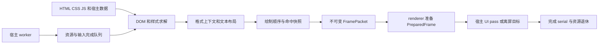

# Weft 核心架构

设计基线日期为 2026 年 10 月 7 日。本项目自研 DOM、CSS 语义、更新机制、绘制组织和宿主接口，面向 Windows、Android 和 iOS 游戏 UI。此文规定实现时的合同；当前已有 M0 核心与探针，实际行为和平台证据见 [status](status.md)。下列完整架构尚未全部实现，候选基础库与性能目标均需验证。

当前新增受限 React/Vite 页面链路：native DOM owner 复制值快照，经 inline-style/Flex adapter 和文字塑形生成 GPU-free Page，再由实验 D3D11 runner 准备/提交/退休。JS 和 Node 不进入 renderer，unmount/reset 后快照仍可绘制。该实现不是通用 HTML/CSS parser 或稳定 FramePacket API，实际范围见 [React 页面](react-vite-probe.md)。

当前又增加独立 Windows HWND/swapchain 主鼠标宿主：WindowProc 只排队值，owner 命中前 flush 布局，以弱节点身份派发真实 MouseEvent；GPU completion 覆盖 UI 与宿主合成，resize/close 在安全点处理。单击、取消、隐藏节点、共同祖先与实际提交通过；完整 PointerEvent/focus/IME、CSS/HTML 加载尚未实现，见 [窗口合同](native-window-probe.md)。

现已增加独立实验 C ABI renderer facade，D3D11 reference adapter 与窗口经过 function table。通用层校验能力/owner/instance/epoch，并跟踪 prepared/use 的提交与退休；各 adapter 解释自己的 native pass，宿主提交/显示/提供完成。Vulkan adapter 已接入（2026-10-12），原生 Metal adapter 尚未实现，见 [后端 API 合同](render-backend-api.md)。

2026-10-08 增加 flow 值接口：自己的 inline 行盒/Unicode 断点与 Yoga block/Flex 约束组合；owner 按 identity 保存 scroll，同步 geometry host 每读全量重算且禁止 JS 重入，snapshot 复制偏移/几何。圆角 clip chain 为不可变值，reference 准备阶段合并 coverage/image，renderer C ABI v1 不变。libunibreak 6.1 的有界 UAX14/29 数据已固定；scroll job 当前微任务时序、跨源 shaped cluster 与实体输入限制见 [实际合同](flow-layout-probe.md)，不提升后文完整设计的实现状态。

2026-10-09 固定 gallery scene 接入 owner 直接 task/rAF 调用、弱身份 mutation journal/subtree revision、API 无关数值 paint 参数与有界静态绘制参数缓存。owner/renderer 线程边界、完整 packet、group opacity/clip 和真实 completion 退休不变；同步 geometry read 仍全量 fresh layout，未实现一般增量 DOM patch、后台 UI 线程或生产 retained display list。实际接口、参考路径与限制见 [本轮合同](owner-hotpath-performance.md)。

## 范围与设计原则

支持范围由 [兼容表](compatibility.md) 管理。优先把游戏 UI 的完整动态链路做正确，再扩大属性、DOM API 和前端框架范围。保留熟悉的标准行为；做不到的行为明确报出，不能用近似行为冒充兼容。

宿主引擎尚未指定，因此核心不依赖 Unity、Unreal 或窗口系统。标准 C ABI 与可选 C++ 包装层是稳定集成边界。窗口、输入法、渲染后端和引擎插件分离。

首版选择单 owner 线程、纯测量函数、不可变渲染包和保守失效。多线程布局、精细脏区域、自动图层提升、完整浏览器调试协议均放在性能证据之后。

## 模块与数据流

| 模块 | 责任 | 边界 |
| --- | --- | --- |
| core | 句柄、allocator、错误、时间、统计、队列和 epochs | 不依赖窗口或 GPU API |
| dom | 树、属性、文档、节点身份和 mutation | 不持有 Yoga 节点或 GPU 对象 |
| style | CSS 解析、层叠、继承、单位、计算样式和依赖 | 不执行绘制；统一 property registry |
| layout | block 与 inline 调度、Flex adapter、约束和几何 | 输入为计算样式与内容版本；禁止脚本重入 |
| text | Unicode 分段、字体回退、塑形、行布局、编辑坐标 | 多约束测量与最终排版共用算法；绘制与 caret 使用最终 GlyphRun |
| paint | 层叠顺序、裁剪、绘制项、分组和命中顺序 | 不访问后端对象；快照没有 Node 指针 |
| script | VM adapter、DOM 包装、任务与事件 | VM 候选是 QuickJS-NG；JSValue 不跨线程 |
| assets | 宿主文件请求、图片和字体版本、取消与缓存 | 同步回调也只入队；加载策略归宿主 |
| renderer | 绘制 IR、resource versions、batch 和退休 | 后端在宿主指定线程执行 |
| platform | 输入、IME、窗口度量、暂停恢复 | 原生线程使用版本化输入镜像 |
| devtools | 检查、失效原因、性能、捕获和重载 | 开发能力可从发布构建移除 |

第三方对象只出现在相应 adapter 内。初期用普通容器和 RAII，加必要的局部 arena；没有测量证据前不引入 ECS、全局自研 allocator 或大规模模板框架。

## 宿主接口与所有权

公开 C ABI 使用不透明 Runtime、View、FramePacket 句柄，定宽整数、指针加长度和带 struct_size 的版本化结构体。错误返回 CeResult，诊断有 code、源文件与位置、View/Node 身份和 message。跨边界不传播异常、STL 或第三方类型。

接口分为创建销毁、owner 线程操作、跨线程入队、包消费与退休。每个入口单独标记线程要求；跨线程安全不意味着可以并发修改 View。

| 概念操作 | 合同 |
| --- | --- |
| CreateRuntime 和 CreateView | 固定 owner；提供 allocator、资源、日志、任务和 renderer 能力 |
| EnqueueInput 和 CompleteAsset | 可从已注册外部线程入队；参数在返回前复制或转移所有权 |
| Advance | owner 调用，使用宿主单调时间；处理有界工作并生成或复用快照 |
| AcquireLatestFrame | 消费者取得只读包；没有新包时可继续使用当前包 |
| PrepareFrame | renderer owner 解析资产版本、准备 atlas 与 batch，得到 PreparedFrame |
| EncodeFrame | 在宿主 context 中录制 UI 命令，返回持有资源使用的 UseToken；不自行 submit 或 present |
| NotifySubmitted | 宿主实际提交后，把 UseToken 绑定队列身份与单调 submission serial |
| DiscardEncoded | 宿主取消未提交命令，释放 UseToken 的录制期资源 pin |
| NotifyCompletedSerial | 确认对应队列的工作完成，允许 GPU 资源退休 |
| ReleaseFrame | 释放 CPU 持有；不能代替 GPU 完成确认 |
| ReleasePreparedFrame | 释放准备包的缓存引用；录制与已提交资源仍由各 use pin 保活 |
| DestroyView | owner 停止脚本并取消请求；已提交 GPU 资源继续由 Runtime 退休管理 |
| DestroyRuntime | 停止 producer 后清理；存在异步 lease、录制包、GPU 使用或外部纹理 lease 时返回 busy |

与引擎的数据与调用（每帧位置用的锚点、带类型的事件与调用、视图模型）的设计见 [与引擎通信](engine-communication.md)（第 13 步）。已实现锚点（下文“锚点”）、桥接（下文“引擎桥接”）与对外 View（下文“对外 View”）及其 C 接口，包括渲染 View 的帧（13.3b）与页面显示引擎的纹理（13.3c）。

字符串输入只在调用期间借用，异步使用必须复制。返回缓冲区通过本库的释放接口或约定 allocator 释放，避免跨 CRT 释放。宿主回调不能抛异常或同步重入 View；要执行 DOM 操作时排入下一安全点。

独立 sample 可以提供 SubmitFrame 便利封装，但必须内部经过 encode、实际 submit 和完成协议。引擎集成时，UI 只是宿主 command buffer 的一部分，不能替宿主独立提交。

内部可以使用异常保证构建事务的资源安全，ABI 入口统一捕获并转换错误。每次 DOM mutation 自身原子，不能留下半连接的树；OOM 或执行上限故障不回滚整个已执行 JS task。放弃尚未发布的派生结果，保留最后有效 FramePacket，把 View 标为 Faulted；停止残余任务，直到显式 reset/reload。Faulted View 的普通操作返回错误，避免把旧画面和新 DOM 当成一致的正常状态。不会把不可中断的原生布局谎称为可任意抢占。

## View 和节点生命周期

Runtime 管理共享字体与图片缓存、设备资源退休和宿主服务。每个 View 有独立文档、任务队列、焦点、样式环境和 JS runtime，便于脚本异常与 heap 配额隔离。内存压力仍可能影响同一进程，不提供进程级隔离承诺。

NodeId 用 slot index 加 generation，并带 View identity。NodeRef 是 live View 内 owner 线程上的稳定引用；从树中移除的节点继续由 JS wrapper、原生引用或进行中的事件路径持有。节点没有外部根且统一 collector 证明不可达后，slot 才可回收并增加 generation。内部循环不能阻止回收。

DOM 是身份与内容的唯一来源；计算样式、LayoutBox 和 PaintItem 是可重建派生结果。DOM 树、布局树、层叠树并非一一对应。布局需要匿名文本盒，display:none 无布局盒；分组透明度和层叠上下文独立于 DOM 节点关系。

JS wrapper 保持同一原生节点的对象身份。Document、原生 NodeRef、task 和事件路径是显式外部根。节点结构、wrapper、listener 和 expando 的所有强边必须进入同一可追踪所有权图；仅调用 gc_mark 标记 listener 不足以证明跨语言循环可回收。

2026-10-11 重构第 9.4 步后的实现：
- 原生节点与树边在 `dom::Tree`（src/dom），边按 NodeId，树本身不决定寿命；
- 脚本层每个节点有一个包装对象，每条树边在邻居包装上持有一个引用并由 gc_mark 报告，所以存活仍由 QuickJS 收集器判定，内部循环可以回收；
- expando、listener 按 slot 放在绑定表，Canvas 状态放在按 NodeId 索引的旁表。

M0 的优先候选是把节点图映射到 QuickJS custom class graph：真正拥有的 JSValue 边由 gc_mark 报告，原生外部引用登记为 VM roots，arena identity index 与 dirty queue 仅保存弱身份。不得同时保留 collector 看不见的 shared_ptr 循环。这个 bridge 在循环、原生根与销毁探针通过前不视为已确定实现。

finalizer 只释放 owner 上的资源，不派发事件、加载资源或执行布局。禁止把游戏对象裸指针直接交给 JS；用宿主可撤销身份，访问时验证有效性。

首版不向宿主暴露可跨 DestroyView 存活的强 NodeRef，长期引用使用 NodeId。DestroyView 在安全点撤销身份、停止任务、清理所有 native roots 后释放 VM；NodeRef 析构不得在 VM 释放后调用 JS API。已取得的 FramePacket 独立保留资产版本，继续有效直至释放和资源退休。

ViewEpoch 标记整个页面世代；RequestEpoch 标记资源请求；FocusEpoch 标记输入焦点；DeviceEpoch 标记设备和资源世代。不同对象的异步消息验证各自身份，不以一个全局 dirty 位替代。

## 一帧的执行顺序

1. owner 接收宿主度量、资源完成、原生数据和输入，按提交序号保持必要顺序。
2. 执行事件和已就绪 task；每个 task 后执行规定的微任务检查点。
3. 对当前帧领取一次 animation frame 回调，推进 CSS 动画；执行相应微任务检查点。
4. 对变化求解样式，执行布局并完成最终文本行布局。
5. 更新绘制与命中快照，生成 FramePacket 或复用未变化内容。
6. 宿主在渲染线程执行；后续完成确认触发资源退休。

时间来自宿主单调时钟。rAF 不等于游戏 tick：同一 View 的同一绘制机会最多派发一批 rAF；后台行为由显式暂停策略控制。恢复时不会无界补发所有历史 timer。

2026-10-09 的可选 M0 rAF 模块现由 `ScriptDom::animation_frame` 实际驱动，整批共享执行预算并在每个回调后执行微任务检查点。注册/取消、隐藏恢复、代际/GC 与故障合同经过验证；原版 React Spring 三例已修改 native DOM，但尚无其 transform/opacity 绘制验证。公共 View/C ABI、旧 motion 时钟和完整 document lifecycle 不因此扩张，见 [gallery/rAF 实际合同](gallery-foundation.md)。

默认 task、微任务和 JS 执行有资源与时间上限。QuickJS interrupt 只在 VM 检查点终止脚本；原生桥接函数必须自己有界。微任务无限生成等情况走 Faulted 策略，残余队列不在下一帧自动续跑；不把任意截断微任务当作正常浏览器行为。

DOM mutation 在 owner 上立即可见，样式和几何延迟计算。getBoundingClientRect 等同步读取 flush 当前必要样式和布局，但不触发 GPU 提交。布局与文本 measure 内部绝不回调 JS，防止重入修改派生树。

输入命中之前，若前一个任务已改变几何，则 flush 最新命中所需布局；绘制延迟可能造成视觉与输入的有限时间差，应在 trace 中记录。平台坐标先映射到逻辑视口，再按逆变换和裁剪链命中。

首版允许同步全量 flush，优先正确性；统计 flush 的触发位置和耗时，再优化读取与 mutation 的交替行为。

## 样式与属性注册表

一个 property registry 定义解析类型、初始值、继承、计算规则、布局与绘制影响、插值和支持阶段。兼容表、诊断和 mutation 失效分类从同一来源生成，避免文档、解析器与优化代码分别维护。

首版实现 UA、作者样式、inline、important、选择器 specificity 和 source order。不支持 cascade layers 等能力时由构建工具诊断。自定义属性和 var 的实现放在基础层叠稳定之后，需覆盖继承、fallback、循环和 computed-value 阶段失效，不能只做字符串替换。规范依据见 [CSS Cascade](https://www.w3.org/TR/css-cascade-5/)。

当前 M0 已抽出纯值 `weft::style`，供文档格式化器与 scene 共用有界 cascade/selector/var 求值（2026-10-11 起页面只有一个样式 profile `document_style_profile`）。选择器引擎在 `weft::dom`（`dom/selector`），样式层叠与 JS 的 querySelector/matches 共用同一文法与匹配，经元素访问器 concept 分别读取快照和活 DOM。主题/属性更新走全量重算，输出与 DOM 快照配对；稀疏值表还不是完整 computed-style/property-registry API，也没有 revision、失效缓存或 JS getComputedStyle。循环按当前 substitution-context 的选中分支规则处理，token 复制/继承/展开有预算，实际范围与浏览器证据见 [公共样式探针](style-cascade-probe.md)。

规则索引按 tag、class、id 等简单特征筛选，最终仍执行完整选择器匹配。祖先 class、id 或继承属性变化，保守检查相关后代。首版不支持 has、复杂 sibling 和 positional selector，避免在未具备依赖记录时承诺其增量正确性。

缓存不只使用 dirty flag：样式 key 包含 rule generation、节点属性、继承输入、viewport/media 环境；文本和布局 key 还包含约束、字体、内容和资源版本。未知依赖采取保守失效。

## 布局与 Yoga 边界

格式上下文由自己的 dispatcher 选择 block、inline/text、flex 或 absolute 计算。LayoutInput 明确 available size、definite/indefinite、min/max-content 请求和布局方向；LayoutOutput 包含 content/padding/border boxes、baseline、scroll extent 和 overflow bounds。

产品架构中 Yoga 候选负责 flex adapter。当前 M0 自动布局另有明确限定的零 margin/border block 子集，将其降为不 grow/shrink 的 column packing；不用于一般 block，扩展前须建立独立 block 算法，实际合同见 [自动布局探针](automatic-layout-probe.md)。computed style 的 Web 默认值、box-sizing、flex shorthand、单位和 containing block 先由自己解释；UseWebDefaults 并不解决全部差异。[Yoga 样式说明](https://www.yogalayout.dev/docs/styling/)

当前独立实现固定 Yoga 3.2.1，并保存 indefinite column 的 length flex-basis 补丁；33 个浏览器对照场景通过。探针输入是显式样式值树，不是 DOM/computed style，未实现此章节的完整格式上下文与失效系统。真实结果和限制见 [Flex 与字体探针](layout-text-probes.md)。

保留 div=block、span=inline 等 UA 默认值。最早探针页面显式使用 flex 容器；尚不支持 block/inline 布局时返回 profile diagnostic，不静默把一般 block/inline 映射成 flex；受限 block lowering 的组合必须显式诊断与浏览器差分。v0.1 目标在前端框架验收前加入定义清楚的简单 block flow 和文本格式上下文。margin collapse、float、table 和 grid 不在 v0.1 范围。

内部文本测量返回约束下的尺寸与基线；Yoga adapter 分别接入 measure 与 baseline callback。measure 不能创建另一棵 DOM 或决定最终绘制坐标。固定尺寸节点可能不执行 measure，因此最终 GlyphRun 必须按最终 content-box 宽度完成布局，不能复用一份过期的中间测量结果。[Yoga 测量合同](https://www.yogalayout.dev/docs/advanced/external-layout-systems)

跨格式上下文通过纯 intrinsic measurement 和最终 layout 协议组合。最小内容尺寸、百分比不确定性、基线和自动最小尺寸必须有明确测试。若 adapter 需要为某些功能建立第二套真实布局，判定探针失败，改用自研对应算法。

逻辑几何使用 CSS px 浮点值；设备缩放在统一栅格阶段处理。相邻边界共享取整规则，避免逐节点取整导致累计缝隙。DPR 变化会失效字形栅格缓存，但不自动改变逻辑 CSS 尺寸；宿主 viewport 变化则重新计算对应布局。

M0 flow 可见窗口现实际验证逻辑 640×420 → 3840×2160 raster → client 的两级变换。glyph 在设备字号重新栅格，owner geometry 保持逻辑值，输入保存消息收到时的合成 viewport。固定 CSS/字体资源下，owner 比较含 epoch/identity、属性、文本、子节点顺序和滚动偏移的完整拥有值快照，输入完全相同才复用几何；scroll-only 复用 computed style，但重算几何。4K 实验宿主已接最多两帧在途；UI/HUD/constant buffer/query 的使用持续到真实完成，队列满、截图、缩放和退出仍可阻塞 drain。尚无生产 revision 失效调度、多线程 renderer 或移动提交验证，见 [4K/FPS、滚动缓存与两帧证据](flow-input-window-probe.md)。

连续运动 demo 由同一 UI owner 在输入检查点之后、生成布局之前调用局部 JS `__ceMotion.tick`，复制浮点毫秒时间而不复制 Node/JSValue。演示按经过的可见时间修改两个元素的 inline `left`，经全量 cascade/layout 生成独立绘制包；绿色元素另按 30 Hz 采样保持。暂停/不可见时冻结运动，恢复先重新锚定；退出移除 listener 和演示节点，再 unmount 原始 React。这是 probe-private 演示调度，未改变通用 task/rAF、CSS animation 或 renderer C ABI 合同，见 [实际范围](flow-input-window-probe.md#连续运动展示2026-10-09)。

## 增量更新的正确性

先实现可重建所有派生结果的全量路径，再实现增量路径。两条路径使用相同的语义算法，独立决定更新范围；差分能检测失效遗漏，不能代替与规范或浏览器的差分。

| 变化 | 最低失效范围 |
| --- | --- |
| 插入、移除、重排节点 | 相关规则匹配、移动子树的祖先选择器与继承、原/新父格式上下文、受影响兄弟、绘制与命中顺序 |
| class/id/属性 | 当前元素；有祖先依赖时检查相关后代；按 computed diff 继续传播 |
| 文本或字体版本 | 塑形和 intrinsic size、所属行、父格式上下文及受影响兄弟 |
| width/height/padding/flex | 所属格式上下文及尺寸依赖；新几何影响绘制与命中 |
| color/background | 对应绘制项；继承 color 与 currentColor 包含受影响文本、边框和其他依赖项 |
| display/position/z-index | 盒结构、containing block 或层叠结构与命中 |
| transform/opacity | 通常无需重做尺寸；若改变 containing block 或分组语义，扩大失效 |
| scroll offset | 变换、可见性和命中；scroll extent 不因单纯 offset 变化重算 |
| viewport/media 条件 | 相关样式；无法精确判定时全量样式与布局 |

首版失效单位为格式上下文或可证明独立的子树，避免一开始追求逐字段的最小传播。受影响布局输出不变时可以停止更高层传播，但要比较所有相关尺寸、baseline、overflow 和 intrinsic 输出。

静态 View 在无内容、样式、资源、输入状态或动画变化时，style solve、layout 与 paint-list rebuild 次数为零。GPU 仍可以执行已缓存绘制包，不能声称零绘制。

渲染侧按内容复用（12.1）：SVG 元素的派生值按视图与元素身份保存，元素自己的标签、属性、样式与文字逐项相同才复用；文字图像按绘制来源（不含身份）、缩放与边距建键，换了节点的同样文字也复用；路径覆盖率按路径内容摘要、描边、设备映射与遮罩建键，命中时再核对路径。三者都要求带缓存与不带缓存的结果逐字节相同，由随机编辑差分验证。SVG 的矩形、圆与线段在盒子能精确表达时画成盒子（12.2）：填充、实线描边（向外长出半个描边宽度的边框盒子）与线段的三种线帽，不经覆盖率光栅化，按批绘制；其余形状仍是路径。路径覆盖率与单色文字每像素存 1 字节（12.3）；小的文字、阴影与路径图像放在按格式分页的图集里，相邻的盒子与同一页的图像合成一次绘制。图集里的图像与独立纹理的采样坐标末位舍入不同，边缘像素可差 1–3 级。文字阴影、svg 的 drop-shadow 与内阴影（13.4a）也是 CPU 上准备、按内容缓存的覆盖率或阴影图像：文字阴影是该行文字的覆盖率经高斯模糊（键里多了模糊的标准差），路径阴影把 svg 的路径与形状在偏移位置重新栅格化、合成一张后模糊（按各路径的内容摘要、映射、描边与遮罩建键，命中时再核对路径），内阴影与外阴影同一个缓存（键里多了是否内阴影）。它们和其他条目一样进图集、按批绘制，锚点移动的元素只在元素原点处准备一次，所以每帧的移动不增加 CPU 工作。

普通绘制命令重用不等于保存渲染纹理。直接绘制时宿主每帧重画 UI；首版离屏目标整体重画，后续脏区域缓存必须额外考虑移动前后的 bounds、阴影、裁剪和背景恢复。

## FramePacket 与 GPU 生命周期

UI 发布的 FramePacket 包含纯 PaintSnapshot：值型绘制项、逻辑几何、变换与裁剪、层叠/分组顺序、字体图片的不可变版本 lease、glyph ID 和逻辑位置，以及诊断统计。无 Node 指针、Yoga 节点、JSValue、atlas UV 或 GPU 对象。CPU 快照可共享不可变块，首版先保证结构正确。

renderer owner 把 FramePacket 准备为 PreparedFrame，解析当前 DeviceEpoch 资源、执行字形栅格与 atlas 分配、准备上传和 batch。PreparedFrame 才持有具体 atlas UV、纹理/缓冲、staging 和资源 pin。长期静态 FramePacket 不固定某个设备的图集页，允许资源驱逐、DPR 重准备和设备重建。

资源 broker 保存不可变资产描述与各设备世代的创建/上传状态；其状态不随 latest-frame 丢弃。FramePacket 声明完整依赖集合，不携带必须按前一包执行的 GPU delta。创建、录制、提交、ready 和失败状态分开，取消 command buffer 或设备丢失不得留下假 ready。首版资源上传与绘制在同一宿主队列排序，多队列另扩展同步合同。

默认最多保留两个未消费的 FramePacket，生成更晚的包可以替换旧候选；输入、事件和资源完成不随丢帧丢弃。每个 View/Surface 的 PreparedFrame 缓存默认至多两个，外部持有同样受 Runtime 资源配额约束。未提交 UseToken 默认也最多两个，超限返回 busy，不阻塞游戏线程或无界积累。已经提交的在途数量由宿主上限控制。

CPU 资产 lease、PreparedFrame 的缓存引用、录制期 UseToken pin、已提交 GPU pin 和外部 texture lease 分开。资源从 prepare/encode 时被保护，录制取消可解除该 use pin，实际提交则持续到队列 completion serial。CPU ReleaseFrame、等待固定帧数或编码结束都不能代替完成确认。

2026-10-09 外部纹理 lease 扩展已实现：prepare/encode 前在通用 facade 保护带 epoch/generation 的 registry import，release 调用方立即使句柄失效，已有使用持续到真实完成；最后一个 pin 释放后通知宿主退休，abandon 原因只在宿主保证无访问后报告。首版同 device/queue、内容不可变、linear-premultiplied RGBA；D3D11 native reference 验证 format/origin/alias，其他 API 尚未实现。生产者独立 GPU 工作由宿主保护，当前没有跨线程资源 broker/多队列同步，见 [实际外部纹理合同](external-texture-lease.md)。

2026-10-09 的 probe-private D3D11 `TwoFramePipeline` 已实际验证两份有界宿主提交记录：每份拥有独立 constant buffer/event query、录制 command list 和 immutable host/HUD lease。UI 与 host-only composition 都占一个 slot；只读取队列头的真实完成 query，完成后才通知 serial、释放 pin/lease 并复用 slot。输出离屏 RT 在同一队列上按“UI 写入 → host 合成读取 → 后续 UI 写入”排序，无 CPU 改写其像素；swapchain/readback 必须在实际 drain 后缩放/读取。一个已提交上传允许后续同队列 use 复用；只有真实完成才转 Ready，未提交/取消的上传仍独立重传。样例没有另加等待绘制包队列，每 tick 消费输入后生成当前完整包；设计里的通用 latest-frame 调度和其他 API 后端尚未实现。

Encode 在录制之前预留提交追踪容量，合法的 NotifySubmitted 在实际 submit 之后不得再因容量、shutdown drain 或资源失败而拒绝，也不得分配内存。错误通知保留所有 pin，宿主纠正后重试；实际已提交的命令不能走 DiscardEncoded。队列 serial 由宿主产生，0 保留为未提交；同一次实际提交可以对应多个 token。完成值必须来自真实 GPU timeline，可超过最后一次包含 UI 的提交，因为同一队列也包含游戏工作。完成值只允许单调推进；宿主先确认 submit，再通知 completion。

Glyph atlas slot/page/version 在相关 PreparedFrame、UseToken 和 GPU 使用期间固定。不得用 LRU 覆盖仍在绘制的区域；区域不搬移，只在没有任何缓存、pass 或宿主租约持有其图像（最后一个采样它的帧已确认完成）之后才在页内重用（12.3 起；此前页面 append-only）。图像替换、staging 和引擎纹理遵循相同规则。每个 worker 的 FreeType face 独立或在明确 owner 上串行使用，不能把可变 face 无锁共享。

场景帧作为不可变值跨线程，释放最后一个引用会逐节点析构整棵树。宿主应在渲染线程之外释放用完的帧：画廊窗口交给一个回收线程，K 线每次重绘因此少约 0.4 ms。

资源完成通过独立存活控制块的 CompletionTicket 入队，ticket 不直接保留可失效的 Runtime 指针。shutdown 先停止 producer、撤销/排空 tickets，再丢弃未录制包与取消未提交 token，等待或退休 GPU 使用。DestroyRuntime 对未清理 lease 返回 busy，不能销毁控制块后依靠 epoch 防止访问已释放内存。

真正 device lost 时由宿主确认旧设备不再执行或访问资源，再调用 AbandonDeviceEpoch 解除不可能等到完成的旧 GPU pin；资源 broker 在新 epoch 重建。surface 暂时不可用并不意味着可以 abandon 设备。

## 绘制顺序与后端

先生成正确的层叠和裁剪顺序，再对相邻、状态相容的绘制项 batch。透明项不得为了减少 draw call 随意排序。命中遍历与实际绘制顺序关联，不能只反向遍历 DOM。

默认直接绘制到宿主 UI pass；opacity group 等需要整体合成的语义、宿主要求的纹理 UI 或特定效果使用离屏 pass。对重叠子元素，给每个子元素单独乘父 opacity 不等价于整体 opacity，必须测试。

首版支持实体矩形、图像、灰度字形、基础边框和圆角，以及 D3 图表所需基础 SVG。轴对齐矩形用 scissor；圆角与旋转裁剪通过自己的受限 clip mask，嵌套深度有能力上限与诊断。若后续用 stencil，必须有专用 attachment 或宿主显式位域 lease 与清理合同，不能借用任意宿主 stencil 位。SVG filter/foreignObject、复杂效果和 backdrop-filter 后续逐项加入，不隐式退回整页 CPU raster。

SVG 作为 DOM 的 namespace 和独立图形格式上下文，不能把 rect/path 等子元素套进普通 CSS box flow。HTML 布局决定 svg viewport；viewBox/preserveAspectRatio 产生局部坐标变换，g/shape/text 继承 SVG 样式并生成同一 paint IR。fill/stroke/currentColor、presentation attributes 与 CSS 层叠、path 命令和 stroke、文本位置/锚点均有独立 fixture。D3 axis/shape/transition 和交互实际使用的接口决定增量实现顺序。[D3 使用](https://d3js.org/getting-started)、[SVG 规范](https://www.w3.org/TR/SVG2/)

第三方库按执行、DOM、绘制、调度与交互分级验收。D3 数据绑定能运行只是 DOM 证据，不代表绘制支持；最终必须在自己的渲染后端画出更新图表。前端库无需维护项目专用分叉，测试采用固定版本原包。

图形 API 通过 adapter 注册，DOM/layout 与绘制快照不绑定某种 GPU API。第一实际 reference adapter 为 Windows D3D11；下一候选为 Vulkan，原生 Metal 可独立注册，GLES 或宿主自定义 adapter 也沿用同一生命周期合同。API enum 不代替真实后端实现，各自 native context、target、shader 和同步分别适配；不要求所有平台经过 Vulkan/MoltenVK。窗口/surface 与 device/queue submission 保持在宿主壳。

固定 CRPG gallery 新增 Canvas2D workload 目标；WebGL2/Three.js 于 2026-10-12 移出需求，3D 内容由宿主引擎渲染、经外部纹理合成，见 [决策](decisions.md)。计划将 canvas backing 与宿主 viewport 的输出统一为带设备/资源代际、颜色/alpha 与 producer/consumer 同步的外部纹理 lease，仍按真实提交完成退休。宿主 viewport 是引擎内容进入 UI 的入口。可选原生 Canvas2D context 已实现，公共 external texture lease 的首版 linear 输入已实现，见 [合同](external-texture-lease.md)。当前 owner 通过图形 API 无关的 raster factory 调用 Windows D2D SOFTWARE/WIC，发布独立完整的不可变 sRGB straight RGBA8；encoded premultiplied WIC 数据先解除预乘，再经 renderer 的 sRGB decode/linear-premultiply。Canvas 状态与 context 包装放在按 NodeId 索引的旁表（`dom::NodeTable`），不在节点上；canvas 元素与 context 的互持边由 QuickJS tracing 显式标记，detached context 保活 canvas，reset 撤销身份但不改已发布像素。renderer 只接收拥有像素资产，不解析 Node/JSValue；真实 query 完成后退休。软件路径是正确性基线，移动与 GPU 共享纹理仍未实现，见 [Canvas 证据](gallery-canvas.md)。

RendererCapabilities 明确纹理格式、最大纹理尺寸、clip 深度、离屏能力和颜色空间。命令的 shader/material ID、blend、纹理与目标类型形成显式 key；进入 pass 前校验必需能力，不能画到一半才静默跳过。

v0.1 设计默认采用 linear-sRGB 内部合成，以便接入游戏的线性渲染 pass；这是主动声明的视觉边界，不承诺浏览器透明混合的逐像素一致。所有后端及 direct/RTT 采用同一默认，不能由 adapter 各自选合成空间。M0 颜色探针须验证并记录 [颜色决策](decisions.md)，探针失败先修合同再扩展后端。

当前 Windows 独立 D3D11 硬件/WARP 探针已通过实际颜色、alpha、query completion 与 native registry 退休验证；只有固定场景与目标格式，尚非本章节的通用 renderer API。该诊断宿主中的 wait/readback 不进入 Encode 合同。见 [实际证据](gpu-probe.md)。

CSS 与普通 PNG 输入按 sRGB 来源解释，先 transfer decode 到线性，再 premultiply；alpha/灰度 coverage 与 SDF distance 不经过颜色 transfer。内部纹理标明 linear premultiplied、输入 sRGB straight、coverage 或 signed distance；距离场还记录 zero、range 和 generator，不能作为 coverage 直接混合。禁止对已经 premultiplied 的 sRGB RGB 直接做 transfer；外部纹理必须提供 alpha/encoding 元数据。输出到 sRGB attachment 由后端正确编码，linear target 不重复编码；HDR 需要明确宿主颜色转换，v0.1 不宣称完整 HDR 支持。

引擎 pass 明确 render target、load/store、viewport、scissor、资源状态与同步责任。宿主 texture lease 规定底层对象寿命、同步和采样格式。UI 后端不隐式 GPU wait 或 readback。

## UI 着色器效果、粒子与背景拷贝

2026-10-12 的设计，尚未实现。目标是游戏 UI 里的小型 GPU 效果：烟雾、发光、溶解、粒子，以及之后的扭曲与毛玻璃。它们不经过 WebGL（见 [决策](decisions.md)），而是 paint IR 的绘制项，由每个后端的同一个渲染器绘制，遵守既有的层叠、裁剪、组合与按完成退休的合同。

**效果**
- 编写：一个 HLSL 像素函数 `float4 effect(EffectInput input)`。
  - `EffectInput` 提供元素盒内的 uv、CSS px 尺寸与盒内位置、设备像素位置、每 CSS px 的设备像素数、时间（秒），以及最多 16 个 float4 参数。
  - 纹理最多 4 张（`effectTexture0-3`），由外壳声明，用线性过滤、重复寻址的 `effectRepeat` 采样：覆盖率资产作为数据放在 r，sRGB 图片作为线性预乘颜色。
  - 返回线性预乘 RGBA，与外部纹理同一约定。
  - 不能使用外壳之外的资源。编译前检查源文件：
    - 不得声明纹理、采样器、常量缓冲或寄存器绑定；
    - 全局量必须是 `static`，因为 HLSL 把不带 `static` 的全局量放进一个常量缓冲；
    - 一个效果是一个文件，不用 include 与 namespace。
  - 这项检查防误用，不防有意用宏隐藏的声明。
  - 最初设计用着色器反射检查绑定。改为检查源文件，是因为它在每个平台、每个编译器之前运行，不需要分别解析 DXBC 与 SPIR-V 的输出，并能指出原因。
- 编译：离线。
  - 工具把效果源与 Weft 提供的外壳一起，编成每个后端、每种合成空间的变体：D3D11 为 DXBC，Vulkan 为 SPIR-V；文档 pass 为线性空间，scene pass 为编码空间。
  - 变体连同清单打成效果包。清单记录名字、参数（名字、类型、默认值）、纹理槽、是否使用时间、是否读取背景。
  - 运行时不带着色器编译器。
- 外壳负责从实例记录取盒与变换、圆角裁剪链的覆盖率与抗锯齿、元素透明度，以及到目标合成空间的转换。效果函数不接触这些。
- 挂接：CSS 图像值 `-weft-effect(name)`，与渐变同属 `<image>`。
  - 首先用于 `background-image`，按背景的绘制顺序、`border-radius` 与裁剪绘制；文档页面与 scene 都可用。
  - 参数来自元素的自定义属性，名字与类型由清单声明。JS 修改参数只需要重绘，不需要重新布局。
  - `-weft-` 前缀表明这是非标准扩展：浏览器丢弃该声明，作者在它前面写后备背景。
  - 未注册的效果名、类型不符的参数给出诊断，不静默降级。
- paint IR：新增 Effect 项，带效果包的版本化 lease、参数快照、纹理 lease 和本帧的效果时间。
  - 时间由 owner 生成帧时按逻辑时钟写入，帧包仍然自给自足；固定时钟下像素确定，可以逐像素测试。
  - 规划器把效果项作为单独的批次（不同管线）；同一效果、状态相同的相邻实例可以合批。
- 后端：管线按（效果、变体、目标格式）懒创建并缓存；效果包卸载后，管线与纹理按完成 serial 退休。
- 调度：清单声明使用时间的效果，在可见时让帧循环持续推进；零面积、被完全裁掉或隐藏时停止。
- 信任：效果是游戏自己的资源，不做 WebGL 那样的安全改写。写坏的着色器可能导致设备丢失，由宿主既有的设备丢失流程处理。

**粒子**
- 无状态 GPU 粒子：每个粒子的位置、旋转、尺寸与颜色，由发射时间、随机种子、粒子序号和当前时间在顶点阶段解析计算（抛物线、阻力、随寿命变化的曲线）。不逐帧模拟、不逐帧上传；同一时钟得到同样的像素。
- 发射器用数据描述：发射形状（点、圆、矩形、元素边缘）、速度范围与方向、重力、阻力、寿命、颜色/尺寸/透明度随寿命的曲线，外观用精灵（图集帧）或效果的像素函数（效果外观尚未实现，见重构计划 11.4 的取舍）。
- 挂接：
  - 常驻发射用 CSS：`-weft-particles: name`，参数用自定义属性，元素可见时发射；
  - 一次性爆发用 JS：`weft.emitParticles(element, name, options)`；
  - 飞向另一个元素的粒子，在发射时取两个元素的几何，沿曲线飞行。
- paint IR：Particles 项，带发射器 lease、仍存活的发射记录与外观。owner 删除已结束的发射记录。
- 粒子在所挂元素的位置参与层叠与裁剪；需要越出元素边界的爆发挂在外层容器上。每个发射器与每帧的粒子总数有上限和诊断。
- 限制：粒子发射后不受动态力（鼠标吸引、碰撞、群聚）影响。需要时增加在 CPU 上模拟的变体，渲染路径不变。
- 实现（11.4a）：
  - paint IR 的 Particles 项带发射器的值（几百字节，按值复制，不另设 lease）与一次发射；精灵是列表的资产 lease；
  - 一次发射一条记录：发射器与时序放在效果参数所用的 16 个字段；绘制为一个实例的 6×N 个顶点，`SV_VertexID / 6` 是粒子序号，记录序号与盒子一样取自实例，所以两个后端沿用既有的记录与描述符布局；
  - 流的时序（最新粒子的序号与年龄）在 CPU 上以双精度算出再写入记录，着色器只做小数运算，长时间运行不失精度；随机数是整数哈希，CPU 参考实现与着色器逐位相同；
  - 顶点阶段每个顶点算一次整个粒子（每粒子 6 次）。4K、40 万个粒子在 RTX 5090 上约 0.7 ms，暂不另设计算 pass；
  - 画在所属元素的背景与边框之上、内容之下，不受元素自身溢出裁剪，与背景相同。
- 挂接（11.4b）：
  - 发射器按名字注册（`SceneParticles`），发射区域相对所挂元素的边框盒：点与圆心取宽高的比例，半径取短边一半的比例，矩形与轮廓取比例；注册的值与覆盖后的值都经 paint 的检查；
  - CSS `-weft-particles: none | <name>`（HTML 元素或 svg 根）：元素显示时（它与祖先都不是 `display: none`）持续发射。覆盖值取元素计算后的自定义属性 `--particles-rate`、`-life`、`-speed`、`-direction`、`-spread`、`-gravity`、`-scale`、`-color`。名字或覆盖值改变时旧流停止、新流开始，停止的流把已发出的粒子播完；速率为 0 不发射；
  - JS `weft.emitParticles(element, name, {count, duration, target})`：owner 记下请求，下一帧以元素那时的覆盖值开始。目标是元素（取边框盒中心）或视口坐标点，在该帧布局之后经发射元素的变换映射到它的边框盒坐标，之后固定；目标不显示时不飞行；
  - 元素隐藏或不在帧里时，它的粒子立即消失；owner 删除粒子都已死亡的发射记录；有粒子时帧持续推进；画着粒子、有发射记录、有等待的爆发或写了 `-weft-particles` 的元素不整棵复用；
  - 种子由元素身份与它已开始的发射数混合：同一时钟、同样的输入得到同样的像素；
  - 上限：每帧 262144 个粒子、帧前等待 1024 次爆发，超过为 scene profile 诊断（每次发射 65536 个的上限不变）；
  - 损伤：每次发射可达的范围（起点区域，加上最长寿命内速度与重力至多带到的距离，有阻力时更短；飞行时包含目标；再加最大粒子的半对角线）经元素映射到视口；在透视平面里为整个目标。

**背景拷贝**
- 清单声明读取背景的效果多一个 `backdrop` 输入。绘制它之前先结束当前批次，把目标上它身后的区域（加上扭曲用的边距）拷到临时纹理，再绘制效果。
- "背后"按 CSS `backdrop-filter` 的语义：
  - 在隔离组里，只有该组已经画的内容；
  - 在最外层，还包括宿主目标上原有的内容（游戏画面），前提是宿主在 pass 中声明目标可读，Vulkan 需要图像带 `TRANSFER_SRC` 用法；
  - 不可读时，最外层的背景是透明的，并给出诊断。
- 代价：每个读背景的效果打断一次批次并拷贝一块区域。移动端的分块 GPU 代价更高，数量与面积有预算。
- 同一机制随后用来实现标准的 `backdrop-filter: blur()`。
- 实现（11.5a–b，scene 页面的 `backdrop-filter`，读背景的效果尚未做）：
  - paint IR 的 Backdrop 项：模糊的标准差（元素 px）、模糊前后的两个 4×5 颜色矩阵（非预乘颜色上，结果钳到 0–1）、圆角，以及 `under`；
  - 一般情况下，Backdrop 项画在元素的一切内容之前，读当前目标；元素的透明度小于 1，或子孙也有 `backdrop-filter` 时，元素成为隔离组，Backdrop 项放在组尾，读包住这个组的目标，以“目标之上”（destination-over）画在组内容之下，再随组按透明度合成。这样与 Chrome 的结果一致：元素的内容在过滤后的背景之上，整体按透明度合成；子孙的背景只看到这个组里已画的内容（它是 Backdrop Root）；
  - 渲染器：结束当前批次，把读的目标上元素设备外接矩形（取整到像素、限在目标内）拷到临时纹理；有模糊前的矩阵时先过一遍；按 Skia 的 GPU 模糊，标准差大于 4 个设备像素时先把拷贝缩到使它降到 4 的整像素尺寸（每轴 `max(1, floor(边长 × 4/σ))`，与 Skia 选的尺寸相同），缩放按面积平均先横后竖（每个输出像素是它覆盖的源像素按覆盖比例的均值，保持平均亮度；Skia 自己的多级双线性缩放在奇数尺寸上会偏暗，见 11.5b），该尺寸下的标准差按每轴的缩放比例换算；再横、竖两遍高斯（半径 3σ，至多 12 个采样），越过拷贝边界的采样镜像回来（Chrome 129 起 `backdrop-filter` 的边缘模式）；合成时按元素的圆角形状、裁剪链与透明度双线性放大采样，再过模糊后的矩阵；
  - 中间纹理都是 8 位编码预乘，与 scene pass 的合成空间相同；D3D11 的临时纹理按格式、尺寸与链中位置复用，两帧没用就释放；Vulkan 用槽位的临时图像（槽位按尺寸保留至多 256 张、共 64 MiB，供它下一次记录），一次记录的所有背景遍的常量放在同一个缓冲里，按设备的 uniform 偏移对齐；
  - 可读性：D3D11 从目标的资源拷贝；Vulkan 需要宿主在 `Target::image` 给出带 `TRANSFER_SRC` 的图像，没有时最外层的背景是透明的，计入原因（不回退）。scene pass 每帧清空自己的目标，所以“最外层”是这个 pass 已画的内容，宿主的游戏画面不在其中；
  - 元素因此成为固定定位与绝对定位子孙的包含块；带 `backdrop-filter` 的子树不缓存成图层；有它的帧，任何变化都整幅损伤；
  - 线性显示列表 pass、C ABI 与 D2D 参考光栅拒绝（诊断）。

## 锚点

2026-10-14 第 13.1 步（CPU 参考路径）。设计与取舍见 [与引擎通信](engine-communication.md#5-锚点)。
- 数据：引擎每帧整份写一张锚点表（`SceneAnchor`：key、View 逻辑 px 的位置、缩放、深度、标志，32 字节），任意线程；`SceneAnchorChannel` 给渲染线程与 owner 各一个三缓冲，写者不等读者，读者只交换索引，读到的总是某一次写的整张表。跨线程只有这些值，渲染线程不碰 Node 与 JSValue。
- 声明：页面写 `data-anchor*` 属性；求解器在 owner 上解析成 `SceneNode::anchoring`，渲染线程只读解析好的值。
- 应用：显示列表与 `SceneGeometry` 共用一个定位函数（`scene_anchor_map`）与一个顺序函数（`scene_anchor_order`）。锚点元素在根盒（View）里定位，祖先的变换与溢出裁剪对它不作用（如 `position: fixed`），子孙随它；祖先的透明度照常（含它的组按根盒合成）。同一父元素、同一 z-index 的锚点元素按深度由远到近。
- 一致性：渲染与命中各自取最新的表，可能相差一帧的移动；`missing: stay` 的记忆按使用方保存（预处理器按 view，`SceneGeometry` 按实例），不跨线程共享。
- 不变量：没有锚点表等于空表（锚点元素隐藏）；参考光栅不画锚点元素；含锚点子孙的子树不缓存成图层。
- GPU 路径（13.1b）：场景帧带版本号（`SceneFrame::revision`，求解器在布局或绘制内容变了、或帧有动画时换新）；渲染器为每个视图保留一份 pass，同一版本号的帧只上传这一帧的锚点（每个锚点元素 {缩放, x, y, 显示}）与记录顺序，着色器移动锚点记录。锚点子树留在元素原点，记录记下锚点序号；同一父元素的锚点元素按深度重排时，在一个批次里写顺序缓冲，跨批次则重新准备。锚点子树里有背景模糊、粒子、透视平面或效果时走 CPU 参考路径。
- 版本号的约定：同一版本号的帧画出来相同；在求解器之外改了帧内容的代码要把版本号清零。保留的 pass 只在帧不变时省掉准备，不改变绘制顺序、透明与裁剪的结果（与重新准备逐像素对照）。

## 引擎桥接

2026-10-14 第 13.2 步。设计与取舍见 [与引擎通信](engine-communication.md#6-桥接)。
- 数据：跨线程只有名字与复制好的字节（bridge 值，JSON 文本在给出的线程上先转成它）。`bridge::EngineChannel` 用一把锁保护有界的队列：任意线程投递事件、完成调用、合并视图模型的字段，owner 一次取走全部；队列里没有 JSValue 或 Node。
- 交付：owner 在安全点（`ScriptDom::deliver_engine`，13.3 的推进开始时）把取走的内容在一个执行预算里交给 JS：先是视图模型的批次，再按投递顺序交事件与完成，每项之后一次微任务检查点。处理函数抛出的异常记进诊断，不中断其他处理函数。交付之前 View 先把页面的时钟推到这一帧的时间（13.4，`ScriptDom::advance_clock`）：处理函数、这一帧的任务与 rAF 读同一个 `performance.now()`。
- 页面 → 引擎：`send` 与 `call` 的消息留在 ScriptDom（有界），宿主在 owner 上取走（`take_engine_messages`），取的时候不会进入 JS。同步函数（`invoke`）在 JS 执行当中调用宿主，期间 ScriptDom 的任何接口都拒绝进入（`WEFT_ENGINE_REENTRY`）。
- 身份与生命周期：调用的 id 由通道发放、从不重用；已完成、超时关闭或重置之前的调用，其完成立即被拒绝（Stale），完成与超时相遇时页面一侧把它记为 stale。重置丢弃等待中的输入与页面的消息、关闭全部调用；通道与同步函数属于 View，留给之后加载的页面。
- 值的转换：在原生侧直接建 JS 对象与数组（自有数据属性，`__proto__` 键不改原型），不经 JSON 文本，不求值脚本；从 JS 转出时检查循环、深度与大小上限，类型规则与 JSON.stringify 一致的部分（toJSON、Proxy 包着的数组）照它，函数与 symbol 拒绝而不是省略。

## 对外 View

2026-10-14 第 13.3a、13.3b 步，2026-10-15 第 13.3c 步。设计与接口见 [与引擎通信](engine-communication.md#8-对外-view133)。
- 组成：`weft::View`（`src/view`）在 owner 线程持有一个页面的 VM（ScriptDom）、场景求解器与几何；`ViewShared` 是其他线程能碰到的部分：锚点通道、引擎通道与最近发布的帧，都是线程安全的值与队列，View 销毁后由持有者继续持有。C ABI（`src/core/runtime.cpp`）的 Runtime 用代际槽位存 View，任意线程的入口经一个加锁的表按槽位与代际找到 `ViewShared`。
- 帧：只在场景内容的版本号、View 的大小或缩放变了时复制一份场景树发布（`std::shared_ptr<const ViewFrame>`），之后不再改；渲染线程按帧里的字体目录建自己的 SceneText 重新排版文字，帧里只有值（文字、样式、盒子），没有 Node、JSValue 或 owner 的缓存。
- 一致性：渲染与命中各自取最新的锚点表（13.1）；JS 读几何用推进开始时 owner 取到的表，命中与指针输入时再取一次。
- 错误：页面的异常是诊断，不是 C 接口的错误；VM 资源耗尽使 View 进入 Faulted，直到重新加载，故障消息写明最先达到的上限（VM 内存或执行预算，13.4；页面捕获了内存不足、之后被中断时也是）；宿主回调里的重入返回 `WEFT_BUSY`。
- 不变量：加载总是从新的文档开始（`reset_document`），关闭上一页面的调用、丢弃等待的输入与消息；引擎通道与同步函数属于 View，跨加载保留。
- 渲染（13.3b）：渲染器的 owner 线程经 `weft_renderer_prepare_scene` 准备 View 的帧，内置的 D3D11、Vulkan 后端用宿主的设备把它画在宿主目标的内容之上（D3D11 在 encode 时画在立即上下文上，Vulkan 录进宿主的命令缓冲），锚点在录制时取最新值。后端按 View 的锚点通道保留每个 View 的 pass：通道只有 View 与它的帧持有，View 销毁、帧都释放后通道过期，下一次准备时丢弃那个 pass，不会把一个 View 的 pass 给另一个。见 [渲染后端 API](render-backend-api.md#view-帧2026-10-14)。
- 引擎的纹理（13.3c）：页面只记名字（`-weft-texture(name)`，显示列表的 `DisplayList::textures`），帧也只带名字；宿主在渲染线程上为每次准备把名字绑到它导入的纹理（外部纹理扩展的租约），渲染器在画的时候才按名字取视图，所以 owner 与帧里没有任何 GPU 对象，宿主每帧可以换纹理或重写同一张（live）。租约由准备好的帧与它的使用钉住，按宿主报告的完成退休。

## 文本和字体

HarfBuzz 候选负责字形塑形，FreeType 候选负责字体解析与栅格，ICU4C 裁剪数据候选负责 bidi、grapheme 与行分割基础规则。它们不替代完整文本系统。字体来源、授权和版本单独记录。[HarfBuzz 塑形](https://harfbuzz.github.io/shaping-concepts.html)、[FreeType 文档](https://freetype.org/freetype2/docs/index.html)、[ICU 边界分析](https://unicode-org.github.io/icu/userguide/boundaryanalysis/)

统一流程为文字分段、bidi/script/language run、字体回退、塑形、换行、必要重塑形、最终 GlyphRun 和 caret mapping。intrinsic 测量可以产生临时结果；最终绘制、caret 和最终几何使用按最终约束生成的 run。缓存 key 包含文本版本、字体集合及版本、字号、语言、方向、features、间距和约束。DPR 栅格变化与逻辑塑形缓存分开。

首个验收覆盖打包字体的中文和拉丁文字。基础实现保留 RTL 与复杂脚本接口，但其他文字只有通过字体与排版测试后才列为支持。彩色 Emoji、竖排、通用 SVG 字体与富文本编辑不在首个验收范围。缺字仍保留正确字符边界并显示明确 fallback。

当前独立 FontSet 已验证固定 Roboto/Noto CJK 的 LTR Latin/Han 回退：整个缺字 HarfBuzz cluster 选 face、相邻 span 重塑形，glyph 带集合内 font_id。该索引只在其 immutable font set 下解释；owner 在同一集合仍存活时栅格，FramePacket 复制像素，不让 renderer 访问 face。它不代替上述 paragraph/inline/editing 系统。单行 positioned profile 使用主字体 strut；四个浏览器度量和字体 ID 缓存碰撞证据见 [中文与状态组件](cjk-alert-probe.md)。

2026-10-09 的 M0 优化在同一 owner font 内复用 HarfBuzz OpenType font 对象；immutable FontSet 按完整 UTF-8/字号缓存拥有值塑形结果，上限 1,024 项/4 MiB 有效载荷。4K 样例另在该固定 font set 生命周期内按 font_id/glyph_id/ppem 缓存灰度像素，上限 2,048 项/16 MiB；裁剪缓存键包含拥有值的源图和完整位置、UV、圆角链，上限 1,024 项/32 MiB 输出像素。资源替换必须使用新 immutable 资产/新字体作用域，不支持原地修改。缓存返回值仍独立拥有，无字体/JS 对象进入 GPU；不宣称生产动态 atlas 或通用字体热重载已实现。

编辑与 DOM 的字符 offset 使用 UTF-16 code units；UTF-8 只用于外部文本资产与部分宿主字符串接口。移动、删除和选择扩展使用 Unicode grapheme，不能把字节、code point 或 HarfBuzz cluster 当作所有可编辑单位。每行保存逻辑位置与视觉 caret 的映射。

小字号正文优先使用灰度 coverage，renderer 可选择单通道 SDF 用于已验收的缩放/描边场景。二者共享逻辑 GlyphRun，SDF padding/bearing 只决定绘制 quad，不改变 advance、line box 或 caret。逻辑塑形与 raster 缓存分开；raster key 包含字体版本、glyph/variation、模式、base ppem、spread 与 generator。SDF atlas 存储 linear distance，使用明确零点/range 与导数抗锯齿；普通颜色 mipmap 不适用，超出距离范围的效果需要重建 field。

本轮实际完成 FreeType 单通道 SDF 生成与 D3D11 固定 atlas 探针；React 页面使用独立的灰度 glyph 路径，scene 原生 GPU pass 使用 FreeType 覆盖率图，正式动态 atlas、SDF 页面材质、移动端与 MSDF 尚未实现，验证边界见 [SDF 合同](sdf-font-probe.md)。atlas 有配额、页版本和 GPU 退休规则；字体回退优先打包字体，系统字体可作为显式可选能力，跨平台视觉回归不使用未固定的系统字体。

## 输入与 IME

M0 实现新增逻辑 identity/parent tree 与独立 paint-order hit regions：inline 分片逐个入列，命中按逆绘制顺序检查 rect、viewport/overflow clip 和圆角链。owner 每条输入前全量生成新值，释放回调后再查几何；不得保存 DOM 指针到 render thread。Windows wheel 消息记录 signed screen/client 坐标和收到消息时的 viewport；owner 用该映射处理已排队事件，再运行 React 检查点。重绘 key 包含 scroll offsets，避免纯滚动被 DOM serialization 吞掉。具体支持范围和反例见 [flow 输入窗口](flow-input-window-probe.md)；下文 pointer/IME 仍为设计目标。

输入统一为 pointer、wheel、key、text/edit commands 和 focus，保留平台细节所需的 pointer ID、时间和 modifiers。触摸点击、滚动与 pointer capture 有明确状态机。捕获节点移除要释放 capture 并按已声明事件规则处理 lostpointercapture，不能直接终止物理 pointer stream；View 暂停或宿主丢失输入时可以按策略产生 pointercancel。[Pointer capture 释放](https://www.w3.org/TR/pointerevents3/#implicit-release-of-pointer-capture)

dispatch 开始时固定并保活传播路径，DOM 移动/删除不改变本次路径。每个 target/phase 使用 listener snapshot，同时观察 removed 标记；新增 listener 不进入当前已领取列表。重复派发同一个正在 dispatch 的 Event 返回错误，嵌套派发其他 Event 允许。普通 listener exception 报告后继续派发，OOM/执行上限走 Faulted 策略。[DOM dispatch](https://dom.spec.whatwg.org/#concept-event-dispatch)

首版不把所有 touch 强行翻译成鼠标。hit-test 先求逆变换、检查可见性和裁剪，再按绘制顺序选择目标。焦点顺序与视觉顺序单独处理，不能简单由 batch 顺序决定。

平台输入线程维护由 owner 发布的 EditSnapshot：FocusEpoch、revision、UTF-16 内容、selection、composition/marked range 和 caret rect。Android InputConnection 与 iOS UITextInput 的同步查询从镜像返回，异步编辑命令交给 owner；禁止 native UI 线程、owner 和 render 线程互相同步等待。[Android InputConnection](https://developer.android.com/reference/android/view/inputmethod/InputConnection)、[Apple UITextInput](https://developer.apple.com/documentation/uikit/uitextinput)

连续输入采用 ack/replay 协议：FocusEpoch 标记控件会话，EditEpoch 标记可延续编辑基线。每个命令带基线 owner revision、递增 client sequence 和 preceding sequence；offset 对应 preceding 命令应用后的预测状态。owner 接受完整顺序链，不能要求每条 pipelined 命令都匹配最新 scalar revision。

ack 包含权威文本/selection/composition、owner revision 和已确认 sequence。平台移除已确认命令，在相同 EditEpoch 下对新权威镜像重放剩余命令。JS 程序性改 value、beforeinput 取消或回调改写导致基线失效时，owner 增加 EditEpoch、发送 resync，丢弃旧 epoch 未确认命令；Android 适配器按需要 restartInput。迟到 ack 不得覆盖新 FocusEpoch/EditEpoch 或清掉未确认预测输入。

Android composing span 与 selection 可独立；iOS marked text 与 selection 约束由适配器处理。字符组合不等于每个按键一次提交，Enter 与键盘 action 也须区分。换屏、焦点销毁、软键盘收起和 composition 取消各有测试。

安全区域和软键盘 geometry 从宿主度量更新，并标明 resize 或 overlay 策略；不把安全区域偷偷重复加到所有盒子。无障碍桥接预留语义节点与焦点接口，首版不宣称已支持完整辅助功能。

SurfaceEpoch/MetricsRevision 与 DeviceEpoch 分开。输入事件携带相应度量版本或已按该版本转换的逻辑坐标，owner 保留有界度量历史处理已排队输入；旧 surface 的无法映射事件按明确策略丢弃并取消活动手势，不能猜用新度量。零像素尺寸、surface 销毁或暂无 drawable 时禁止 encode，但可以继续有界 UI 更新；恢复先发布新度量再绘制。暂停停止新 GPU submission，不能只停止 DOM tick 而让隐藏 renderer 继续提交。

## 资源与热重载

首版加载打包的本地 HTML/CSS/JS、PNG 和字体。资源通过宿主 AssetProvider 读取，图片解码在 worker 或 owner 有界执行。没有默认网络请求、浏览器导航或平台文件读取副作用；HTTP/fetch 等作为显式后续能力。

请求以 ViewEpoch、RequestId 和 resource generation 验证，图片和字体在 pending 时有明确占位与 fallback。最终尺寸或字体可用后失效相关测量与绘制。即使宿主同步返回完成，也排入完成队列，防止资源回调重入布局。

热重载构建新的 Document/VM 世代，校验后在安全点切换。失败保持原页面并显示诊断；旧请求、事件和 IME 会话不进入新世代。焦点和状态迁移按显式 key 策略，不能重新套用所有旧 NodeId。

JS 源码或 bundle 为基础资产格式，VM bytecode 仅作为绑定引擎版本与构建配置的可再生成缓存，不能当永久跨版本文件格式。默认不导出 QuickJS 的 shell、std 或 os 能力。

## 调试和证据

实际页面探针目前有独立 Flex 与 positioned 格式上下文。后者通过 CaseCheetah 原样 NineSlice 验证矩形图片裁剪、明确尺寸的绝对定位和受限 stylesheet；owner 生成图形 API 无关的值快照，宿主允许列表加载原图，再转换为 quad/UV/coverage 输入。新增自动布局探针已组合受限 block/Flex/absolute、公共 cascade 与固定 CJK intrinsic measurement；完整文档调度器继续扩展格式上下文，不将它们绑定到 D3D11，也不把探针的 per-frame RGBA32F 图片上传作为生产资源策略，见 [workload 边界](casecheetah-workload.md)。

2026-10-11 重构第 8 步：page、positioned、auto 三个页面 profile 已退役，页面只有一个文档格式化器 `layout_document`（block、flex 与 absolute 经 Yoga，inline 文本按 Blink 行盒，canvas/img 替换元素，视口大小的初始包含块）。第 8.2 步起 scene 与文档共用一个 Yoga 适配器 `layout_boxes`（[flex.hpp](../src/layout/flex.hpp)）：同一套 CSS 到 Yoga 的映射、自动最小尺寸、grid 子集、svg 替换盒与 transform 包含块，文字由各自的文字系统测量。第 8.3b 步起两者也共用一条命中路径（[hit_test.hpp](../src/layout/hit_test.hpp)）：绘制顺序的命中区域、逆平面与裁剪链；paint IR 在第 8 步后续部分合并。

先提供可序列化的 DOM、计算样式、布局盒、paint order、clip、资源账目和失效原因。trace 串联输入、JS task、同步 flush、style、layout、paint、upload、submit 与完成 serial。通过 CLI 或简单检查器使用，之后再决定是否实现 Chrome DevTools Protocol 子集。

每份 FramePacket 可捕获元数据、必要资源和确定性时钟输入，以便离线 replay。初期捕获只覆盖测试资产，不能默认认为可以重放任意宿主纹理或回调。

自动化包括几何差分、视觉回归、输入事件序列、随机 DOM mutation、生命周期与内存压力。支持范围内选取 [WPT](https://web-platform-tests.org/) 用例，并补充实际游戏 UI。参考路径相同算法的共同 bug 要靠独立规范 fixture 和浏览器差分检出。

发布接口、功能支持和性能声明都必须关联具体测试结果。平台后端、字体和 fixture 确定前，不把初始预算写成产品性能。

2026-10-09 Gallery 检查 host 的时间合同补充：同一次 owner opportunity 的 timers 与 rAF 必须使用同一个有限、单调的 double。需要从 C++ 向 JS 传数字时，使用 classic locale 与 max_digits10 的可往返表示；不得分别舍入不同宿主步骤或靠时钟容差掩盖倒退。新增目录 shell 仍在同一 owner 上复制 DOM/几何值，renderer 只读完整不可变包；静态 shell 绘制快照可复用，但每个包独立持有本帧 Canvas 位图和全部字体资产。未提交包可被丢弃，不成为后一个包的依赖。范围与测试见 [检查窗口](gallery-preview.md)。

2026-10-09 CSS/D3 scene probe 补充：owner 在线程内从 native DOM 复制 `DomSnapshot`，公共 cascade 的显式 scene profile 计算声明来源，SceneSolver 求关键帧/transition 和 Yoga 盒子，生成只含 owned strings、数值、代际身份与子树的 `SceneFrame`。同步 geometry host 从最新快照求布局与变换后的 AABB；measure/layout 内不调用 JS。节点动画状态按 view_epoch/slot/generation 隔离，移除后清理，重插入重新开始。

Windows `SceneRaster` 是可替换的软件矢量参考适配器：DirectWrite measure/shape，Direct2D SOFTWARE/WIC raster，输出独立的 straight encoded-sRGB RGBA8。它和 SceneSolver 当前均由 UI owner 调用；既不向 renderer 传 Node/JSValue，也不把 D2D 类型放进公共 backend API。原来的 D3D11 adapter 转 linear-premultiplied 图像并合成完整 FramePacket，按真实完成 serial 退休；之后可以换矢量 GPU backend/字体适配器而不用改变 DOM/动画 owner 合同。公共 renderer/frame/backend C ABI 不变，移动尚未编译。

2026-10-09 性能阶段：相同 owned scene 值可由 Windows 私有 `paint_d2d` 适配器绘制到宿主明确分配的卡片 GPU surface；没有新增公共 C ABI 的 D2D 类型。宿主每卡最多三个 backing version，UI 仍最多两帧在途；有界池只在真实 completion serial 达到该 version 的最后消费 serial、旧 caller lease 已释放后重写。encoded-premultiplied BGRA8 经逐 texel GPU decode 转 linear-premultiplied RGBA16F，再通过既有 external texture lease 作为完整帧依赖；透明输入先转换后滤波，不能在滤波后才解除预乘。CPU WIC 路径保留，固定原例使用不变的 Chrome 阈值分别验证 CPU/GPU。窗口只在当前 viewport 的有效裁剪区绘制；裁剪变化必须发布新完整版本，不能把旧裁剪图用于滚动露出。颜色字体缓存仅缓存有界设备字号文本像素，布局、opacity、transform、命中保持当前值；这是字体适配器缓存，不实现自动图层提升。3D 平面仍使用已有软件投影，重用未变化的平面内容。源/样式 key、布局签名与 full reference 反例见 [性能阶段](gallery-performance.md)。

这是独立、显式有界的 scene formatting profile，旧 flow/auto/positioned profile 的支持范围不随之扩大。固定 utility 编译在构建工具中从原始 sheet 的语义生成，不从浏览器计算样式复制；浏览器 PNG/几何仅用于 oracle。3D 仅验证 perspective(px) rotateY 的平面子树，未形成通用 3D scene。完整范围、生命周期反例和 CPU 成本见 [CSS/D3 证据](scene-gallery.md)。

2026-10-09 复杂 CSS 阶段：显式 projective 平面保留原完整软件展平源图，Windows device context 通过当前 perspective matrix 在 GPU 上采样；不会按普通 transform/opacity 动画自动提升任意节点为图层。对应源 bitmap 属于各完成后可重写的卡片 version 的适配器，target/factory 改变清理资源域，源内容/身份/尺度变化失效。四边同宽同色 solid 可共用一次圆角 ring 描边；异色/不等宽路径保留，同一 geometry/width 的 side wedge 有界复用，不改变 group opacity。动画计划缓存仅在完整 underlying computed style 保持相同时复用；非法计划重试持续拒绝，reset 清理，full reference 每帧重建。证据与界限见 [复杂 CSS 优化](complex-css-performance.md)。

2026-10-09 CSS 中段后续：私有 Windows GPU adapter 将同一 border stroke 与 outer/side mask 的交集编译为 factory-owned filled geometry，完整参数键/256 项上限，较大矩阵走原 mask 路径；software oracle 不变。group opacity/overflow 继续整体合成，没有自动图层提升。owner 的保守布局参考在 layout reuse 时保持不变，返回的新 scene 仍完整独立拥有当前 paint 值；cascade shorthand 展开只缓存 underlying computed 值，逐帧继承/动画与同步 geometry read 不改变。反例与实际调度条件见 [CSS 中段证据](css-middle-performance.md)。

2026-10-09 后续 3/4/5 探针：新增内部 C++ `OwnerExecutor`，每个 runtime 的 DOM/JS/style/layout 仍由同一 UI owner 持有；可靠 owned 输入与可合并 refresh request 分离，最多两个完整 immutable publications，epoch/reset 验证与 close 排空，render 不访问 Node/JSValue。gallery 的真实 34 scene + 2 Canvas VM 统一移到 worker，目录 shell 为主线程独立诊断 runtime；不是并行 DOM。交互 latest 可复用完整旧帧，确定性测试显式 wait，呈现 FPS 与 owner 更新 Hz 分开。外部 C ABI 尚未导出这项 executor。

宿主显式选择源图身份，缓存仅消去根 transform/opacity/位置，保持内容/后代/字体/裁剪/order key；opacity 合成整层一次，不自动提升。D2D damage 相对实际已完成 slot 保存的 frame，未知 bounds/full clip 或 resize 走全量，资源重写/退休保持 actual serial。新 owned `NativeScene` 与 paint commands 不含 GPU API 类型，Windows adapter 实现 shader shapes/gradients/borders、cached glyph/source textures 与隔离透明组；unsupported 完整 scene 继续 D2D，不部分提交。native 全卡 producer、encoded-to-linear conversion、卡片 composite 仍保留，移动/其他 API 未验证。容量、图像与线程反例、实测界限见 [本轮合同与证据](render-stages-performance.md)。

2026-10-10 共享簇扩展：64 个原始 scene 加两例 Canvas 的 VM 在同一 UI owner；shell 是独立诊断 runtime。新增真实 native geometry/computed-style/CTM 读回及布局后 ResizeObserver，callback 不进入内部 layout/measure。可靠输入传值，卡片 capture 路由和 wheel zoom 在 inspection host 显式实现；完整快照与 actual serial retirement 合同保持。固定样例驱动的 SVG、Flex/Grid、事件和 fragment 子集、原例缺陷、Windows 证据与尚未验证能力见 [共享簇实际合同](gallery-shared-cluster.md)，不是一般浏览器支持承诺。

检查宿主按完整可见集回收离屏 backing：只有最后实际消费 serial 已完成且当前无未发布 producer 工作时才释放 caller lease、D2D target 和 native scratch reservation。隐藏本身不等于完成；重新可见必须重建完整源图和新身份版本，不依赖上一未提交快照。128 个 import/512MiB linear payload 与 128MiB native group scratch 上限保持，连续滚动和透明组反复重入反例见共享簇记录。

2026-10-10 Gallery 资源驻留修复：inspection host 显式给出下一完整 packet 的可见集，只回收已由真实 query 确认完成的离屏 backing/lease；在途版本继续持有，重返按当前内容和 crop 生成完整新版本。非阻塞 collection 保持原 128/512MiB 上限，含失败 producer 和两个大卡片的反例见 [共享簇记录](gallery-shared-cluster.md)。这不是核心 renderer 自动根据 DOM 提升或回收图层。

2026-10-10 交互优化补充：同步 geometry/computed-style 的可选 native cache host 用全局DOM mutation revision与宿主layout epoch，回调只比较拥有值，禁止重入DOM/JS。外部时间、viewport、字体/资源等变化必须推动epoch；默认未安装的读取仍全量。缓存只保存owned snapshot/geometry/style，按view/slot/generation验证，reset清空，内部layout/measure不调用JS。公共StyleMemo为编译器代际绑定的owner值缓存：rule winners/computed 两个LRU各2048项/2MiB有效载荷，精确支持范围内的selector上下文、实际继承父值及类型化变量作键，显式inherit/var保守保留完整父值，命中仍收取token-work/output quota。Scene静态子树复用只对完整DOM/computed/实际继承父style相同且无动画状态成立，返回帧仍自包含。

检查宿主对连续待处理Move显式选择latest采样策略，仅同card/buttons且无wheel或测试延迟可合并，执行中事件和Down/Up/Cancel/Wheel/reset保持边界；常规input()可靠语义不变，新增coalesced计数。Unicode/emoji字体图像只去除已经composite的authored transform/opacity冗余，computed字体/颜色/尺寸/文本继续失效。双线程profiler以共同steady-clock微秒时钟写owned数值事件，文件有上限，不改变外部C ABI；具体证据和仍偏慢的K-Line/Anime见[交互阶段](gallery-interaction-profile.md)。

2026-10-11 重构第 9.5 步：快照增量化。
- `DomSnapshot` 记录复制时节点的子树版本号；它不属于内容，`==` 不比较它。
- `dom::Tree::refresh` 与 `ScriptDom::refresh_snapshot` 把旧副本刷新到最新：版本号没变的子树原样保留，工作量只取决于变化部分，并报告内容是否真的变化。
- 宿主几何/样式读保留一份文档副本原地刷新。scene 会话与求解器用 `dom::update_copy` 增量维护副本，用 `dom::same_content` 按版本号跳过未变子树的比较。
- 交给宿主与求解器的仍是完整、自包含的值。

2026-10-10 增量更新补充：`CompiledStyle::update` 保留canonical raw computed值，可报告变化/重建的own节点身份。同父重排保留值，跨父挂载重建；输出不是shorthand展开表示。Scene另存expanded派生值，按changed identities及代际重建，不把展开值写回cascade。`SceneSolver::update`可修改owner专属输出，异常后必须丢弃部分输出/reset；跨线程发布仍创建完整独立immutable snapshot。geometry reuse由字体/文本/盒子/transform/SVG geometry/身份投影证明，pure paint变化不失效，measure/layout仍不调用JS。

检查host区分主动正常ReleaseCapture和真实捕获/焦点丢失；hover/active只更新weak generational旧/新路径。诊断footer在native overlay，原应用DOM/事件正常更新。所有不可见卡片统一暂停rAF、继续timer，属于Gallery显式host策略。详细profiler默认关闭，关闭时无阶段timestamp/trace；保留必要completion及调度/FPS。开启后每线程有界latest trace、600样本曲线、5Hz HUD；串联共同steady-clock和run_id，不能把旧文件或采样子集当全运行。Windows factory-scoped shape/stroke缓存与本次solve局部bounds不跨线程保留DOM引用，GPU重写/退休继续只按actual serial。实际证据见[增量与profiler](incremental-ui-profiler.md)。
