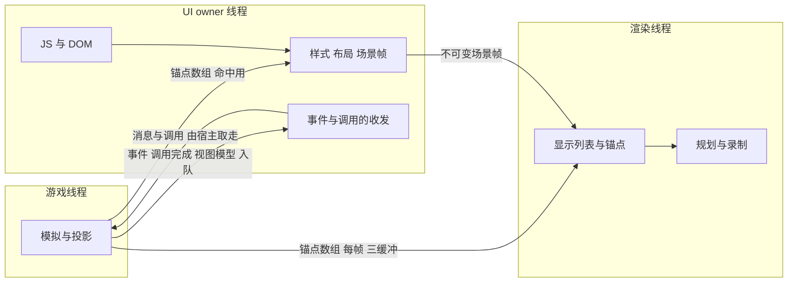

# 与引擎通信：技术路线（第 13 步）

2026-10-14 起草。本文是第 13 步的设计合同与路线；实现状态以 [status](status.md) 与 [重构计划](refactoring-plan.md#第-13-步记录2026-10-14) 的记录为准。已实现：13.1 锚点（CPU 参考路径与 GPU 路径，2026-10-14，内部 C++ 接口）；13.2 桥接（值、事件、调用、同步函数、视图模型与 CRPG 兼容层，2026-10-14，内部 C++ 接口与 JS 平台模块）；13.3a 对外 View 与它的 C ABI（加载、推进、指针、命中、取帧、锚点与桥接，2026-10-14，不含渲染）。

## 摘要

- 问题：血条、名牌、伤害数字这类元素每帧都要跟着游戏里的单位移动。现在 CRPG UI 每帧把所有实例整份推成 JSON，再由 React 全部重渲染；在 Weft 上照做，200 个血条每帧约 13 ms，400 个约 28 ms。
- 关键发现：
  - 传输不是瓶颈。让页面自己算出同样的值（零传输，相当于共享内存交给 JS 的理想情况）也一样慢；贵的是 JS 逐个改 DOM 之后，每个元素每帧要重新求样式、布局、生成场景（约 45 µs）。
  - 现在每帧有一笔与改动多少无关、按整个文档算的固定开销：1,600 个节点的页面只改一个元素，UI 线程约 5 ms、渲染线程约 4 ms。这对所有页面都是问题，不只是血条。
- 方案分三条通道：
  1. 锚点：引擎每帧写一份紧凑数组（共享内存，三缓冲，不加锁），渲染线程画每一帧时直接读最新值去移动元素。不经过 JS、DOM、样式和布局，也不比 3D 画面晚一帧。最终由 GPU 应用：页面没变时绘制记录留在显存里，每帧只上传锚点表，CPU 开销与锚点元素的个数基本无关。
  2. 桥接：带类型的事件、调用（返回 Promise）、同步函数和视图模型，值在原生侧直接转成 JS 值，不再把 JSON 拼进脚本；另提供 CRPG 现有接口的兼容层。
  3. C ABI 与宿主：以上能力进 C ABI，并有一个模拟引擎的宿主样例；UE 插件之后再做。
- 另一条线是增量管线（13.5）：UI 线程只处理变化的节点，渲染线程只重建变化的子树，把上面那笔固定开销去掉。
- 分五段：13.1 锚点（先做 CPU 参考路径，再做 GPU 路径），13.2 桥接，13.3 C ABI 与宿主，13.4 用 CRPG 的浮动 UI 验证，13.5 增量管线。
- 预期：400 个名牌每帧只移动时，每帧 CPU 约 0.1 ms（现在约 28 ms）；同时每帧有 20 个血条掉血时约 1 ms。Gameface 那类数据绑定每帧仍要逐个改 DOM 的样式，位置这件事上锚点要快一个数量级以上。

## 1. 目标与范围

| 目标 | 衡量 |
| --- | --- |
| 每帧移动的元素不占 UI 线程 | 400 个锚点元素每帧移动时，owner 每帧 ≤ 0.1 ms（没有 DOM 变化） |
| 不比 3D 画面晚一帧 | 渲染线程画的总是引擎最后写入的锚点值 |
| 移动的开销与锚点个数基本无关 | 400 个锚点元素只移动时：渲染 CPU p50 ≤ 0.1 ms、p99 ≤ 0.3 ms（GPU 路径；RTX 5090 + 9950X3D，D3D11 与 Vulkan） |
| 改动的开销与改动多少相称 | 1,600 个节点的页面每帧改 1 个元素：owner ≤ 0.2 ms、渲染 CPU ≤ 0.2 ms（13.5） |
| 页面能调用引擎、引擎能通知页面 | 双向事件、带 Promise 的调用、同步函数、视图模型；值带类型 |
| 线程与生命周期安全 | 任意线程可投递；处理函数在 owner 线程；不暴露裸指针；View 销毁后迟到的完成被拒绝 |
| 现有 CRPG UI 能接上 | `window.ue.sendEvent` 与 `window.__ue_dispatch` 不改代码可用 |

本步不做：跨进程通信、调试用 WebSocket、JS 侧的 SharedArrayBuffer、3D 世界里的 UI 面板（渲染到纹理）、UE 插件打包（M5）、不经 JS 的 DOM 数据绑定（`data-bind-*`，见第 14 节）。

## 2. 现状与证据

### 2.1 CRPG UI 现在的做法

CRPG 工程（UE，Ultralight 1.4，模块 CRPGUltralight）的 UI 是 React 19 + Zustand，三条通道都按字符串名字：

| 方向 | 机制 | 说明 |
| --- | --- | --- |
| JS → 引擎 | `window.ue.sendEvent(name, obj)` | 只发不收；引擎侧转成 JSON 文本，再分发给委托与 C++ lambda |
| 引擎 → JS | `CallUI(fn, json)` 求值 `window.__ue_dispatch('fn', <json>)` | JSON 文本直接拼进脚本；字符串未转义，含 `"`、`\` 或 U+2028 时会出错 |
| 视图模型 | `window.__vm_update(delta)` | 只有测试页在用 |

- 没有请求-应答，用成对的事件代替（如 `request_settings` → `loadSettings`）。约 68 种消息，约 40 种是正式功能。
- 浮动 UI（`UWebUIFloatingManager`）：引擎每 16 ms 在 C++ 里投影，把全部实例整份推送（`__floating_ui_batch`）：id、类型、x、y、缩放、是否在屏幕内、是否在相机后、是否在范围内、远近顺序、存活时间和视图模型字段。React 每帧重渲染全部实例；屏幕外的处理（隐藏、贴边、箭头角度）在 JS 里算。
- 实例类型：血条（常驻）、伤害数字（存活 1.75 s）、状态标记（存活 1.7 s）、任务标记（预留）。
- 界面缩放靠 `<html>` 上的 CSS `zoom`，位置要除以缩放；点击是否交给 UI 取决于光标下的元素是否可交互。

### 2.2 Weft 上的基线

`weft_d3d11_probe --hud-benchmark-hardware <dir>`（HUD_TESTS：名字加血条，每帧改 transform，约二十分之一的单位每帧掉血；RTX 5090 + Ryzen 9 9950X3D，固定 CCD0，Release，每档 240 帧中位数）。“零传输”是页面自己算出同样的值：

| 单位 | 方式 | 拼 JSON | 脚本与改 DOM | 样式、布局与场景 | 渲染 CPU | 每帧合计 |
| --- | --- | --- | --- | --- | --- | --- |
| 100 | 推 JSON | 0.05 ms | 0.9 ms | 4.6 ms | 1.0 ms | 6.6 ms |
| 100 | 零传输 | 0 | 1.1 ms | 4.5 ms | 1.0 ms | 6.6 ms |
| 200 | 推 JSON | 0.09 ms | 1.8 ms | 9.2 ms | 2.0 ms | 13.0 ms |
| 200 | 零传输 | 0 | 2.2 ms | 9.0 ms | 1.9 ms | 13.0 ms |
| 400 | 推 JSON | 0.17 ms | 3.6 ms | 20.6 ms | 4.0 ms | 28.3 ms |
| 400 | 零传输 | 0 | 4.4 ms | 20.0 ms | 3.8 ms | 28.2 ms |

锚点模式（13.1a，CPU 参考路径；宿主每帧写全部锚点，掉血时按 JSON 推送变化的血条）：

| 400 个名牌，每帧 | 引擎写锚点与 JSON | 脚本 | UI 线程 p50 / p99 | 渲染 CPU p50 |
| --- | --- | --- | --- | --- |
| 只移动（锚点） | 0.012 ms | 0 | 0.025 / 0.034 ms | 4.2 ms |
| 移动（锚点）+ 20 个血条改宽度 | 0.017 ms | 0.16 ms | 10.7 / 13.2 ms | 4.0 ms |
| 移动（锚点）+ 20 个血条改 `scaleX` | 0.018 ms | 0.33 ms | 7.1 / 10.1 ms | 4.1 ms |
| 对照：推 JSON，每帧改 400 个 transform 与 20 个宽度 | 0.17 ms | 3.9 ms | 23.3 / 32.1 ms | 4.2 ms |

- 只移动时 UI 线程每帧从 23 ms 降到 0.03 ms；渲染 CPU 没变，因为 CPU 参考路径每帧重建显示列表。
- GPU 路径（13.1b）之后：

| 400 个名牌只移动（锚点） | UI 线程 p50 / p99 | 渲染 CPU p50 / p99 | GPU p50 |
| --- | --- | --- | --- |
| D3D11，CPU 参考路径（13.1a） | 0.025 / 0.034 ms | 4.16 / 5.17 ms | 0.08 ms |
| D3D11，GPU 路径 | 0.004 / 0.019 ms | 0.021 / 0.114 ms | 0.06 ms |
| Vulkan，GPU 路径 | 0.006 / 0.029 ms | 0.042 / 0.111 ms | 0.23 ms |

- 掉血时的开销来自整页：一处宽度变化就重新布局整页，只改 transform 也要重新求样式与场景（13.5 解决）。改 `scaleX` 省去布局。

同一页 400 个单位、页面自算，每帧只改其中一部分：

| 每帧改动 | 脚本与改 DOM | 样式、布局与场景（p50 / p99） | 渲染 CPU |
| --- | --- | --- | --- |
| 400 个 | 4.8 ms | 22.6 / 25.3 ms | 4.1 ms |
| 40 个 | 0.5 ms | 7.0 / 18.2 ms | 4.1 ms |
| 4 个 | 0.09 ms | 6.1 / 14.9 ms | 4.3 ms |
| 1 个 | 0.05 ms | 5.3 / 12.1 ms | 4.0 ms |

结论：
- 数据怎么传几乎不影响结果；只要每帧逐个改 DOM，就要付样式、布局与场景更新的钱。
- 每帧有一笔按整个文档算的固定开销（这一页约 1,600 个节点：UI 线程约 5 ms、渲染线程约 4 ms，每个节点各约 3 µs），之后每改一个单位再加约 45 µs。渲染线程每次准备都重建整份显示列表，与改动多少无关。
- 所以每帧变化的视觉量要交给原生侧直接用，而不是交给 JS。
- 只改 transform 每个元素也要约 50 µs，这本身值得优化（13.5）：framer-motion 这类 JS 动画走的就是这条路。

### 2.3 Weft 里相关的现有结构

- 单 owner：DOM、JS、样式、布局在同一线程；宿主可以在游戏线程调用推进，也可以放到独立线程（[决策](decisions.md#单个-ui-owner)）。
- owner 生成不可变的场景帧（`SceneFrame`）发布给渲染线程；渲染线程在准备阶段把场景帧转成显示列表（`scene_display_list`）、规划绘制并录制。现在每次准备都重建显示列表。
- 命中测试在 owner 上，用 `SceneGeometry::hit_test` 对当前场景帧做。
- JS 侧：`ScriptDom`（QuickJS-NG），平台模块提供 Web API；全局 `weft` 对象已有 `weft.emitParticles`。QuickJS 提供 `JS_NewPromiseCapability`、`JS_NewArrayBuffer` 与 `JS_ParseJSON`。
- 公开 C ABI（`include/weft/weft.h`）目前只有 Runtime 与 View 的骨架：创建、销毁、记录时间。加载页面、推进、取帧还在探针代码里（`GallerySceneSession`）。

## 3. 设计原则

1. 数据在用它的地方消费：每帧变化的视觉量（位置、缩放、可见性）交给渲染线程；业务逻辑与低频数据交给 JS。
2. 值带类型，不拼脚本：引擎给的数据是数据，不会被当作代码求值。
3. 跨线程只传值：队列（事件、调用完成）与新值覆盖旧值的缓冲（锚点）；渲染线程不碰 Node 与 JSValue；JS 只在 owner 线程。
4. 句柄与代际：View、调用都用带代际的身份；迟到或过期的操作返回 `WEFT_STALE_HANDLE`，不崩溃。
5. 不重入：宿主回调里不能同步进入 View 的 DOM 或 JS；要做的事入队到下一个安全点。
6. 标准语义不悄悄改变：锚点是 Weft 的扩展，在兼容表与诊断里可见。
7. 先有正确的全量路径，再加增量（保留显示列表），两者结果逐像素对照。

## 4. 总体结构



| 通道 | 方向 | 频率 | 载体 | 消费者 |
| --- | --- | --- | --- | --- |
| 锚点 | 引擎 → Weft | 每帧 | 定长记录数组，三缓冲 | 渲染线程（绘制）、owner（命中） |
| 事件 | 引擎 → 页面 | 按需 | 带类型的值，入队 | owner 上的 JS |
| 消息、调用 | 页面 → 引擎 | 按需 | 带类型的值，出队 | 宿主（在 owner 线程取走） |
| 调用完成 | 引擎 → 页面 | 按需 | 带类型的值，入队 | owner 上的 Promise |
| 同步函数 | 页面 ↔ 引擎 | 按需 | 带类型的值，同步 | owner 线程上的宿主回调 |
| 视图模型 | 引擎 → 页面 | 每次推进至多一批 | 按字段合并 | owner 上的 JS |

线程（推荐的 UE 接法）：owner 就是游戏线程（UMG 与 Ultralight 的推进也在游戏线程），渲染在 UE 的渲染线程，用宿主的命令列表录制。owner 放在独立线程时，同步函数的回调在 owner 线程执行，宿主要自己保证线程安全或改用调用。

## 5. 锚点

### 5.1 引擎侧：写入

```c
typedef struct weft_anchor {
    uint64_t key;      /* 引擎自己的 id，页面用 data-anchor 的十进制写法引用 */
    float x, y;        /* 锚点在 View 里的位置，逻辑 px（与 CSS 布局同单位） */
    float scale;       /* 1 为原大 */
    float depth;       /* 越大越远；同一容器里的锚点元素由远到近画 */
    uint32_t flags;    /* WEFT_ANCHOR_HIDDEN | WEFT_ANCHOR_BEHIND | WEFT_ANCHOR_OFFSCREEN；0 为可见 */
    uint32_t reserved; /* 0 */
} weft_anchor;         /* 32 字节 */

/* 用这一组替换 View 的全部锚点（复制）。读者看到的总是整组新值或整组旧值，不会混合。
 * 任意线程；同一 View 同时至多一个写者。 */
weft_result weft_view_write_anchors(weft_runtime* runtime, weft_view_handle view,
                                    const weft_anchor* anchors, uint32_t count);
```

- 三缓冲：写者写空闲槽，原子地发布；渲染线程与 owner 各自取最新发布的槽。400 个锚点每帧复制约 13 KB，开销可忽略。
- 实现（13.1a，`src/scene/scene_anchor.hpp`）：两个读者各一个三缓冲，写者按 key 排序（同一 key 取最后一条）后写入两份；非法值（不是有限数、负的缩放、未知标志、保留位非零）或超过 65,536 个时什么也不发布。标志为 0 时可见（草案原为“可见”位，改成“隐藏”位，零初始化的记录可见）。HUD 基准里宿主算出 400 个位置并写入，每帧约 0.012 ms。
- 位置由引擎投影（CRPG 现在就是），换算到 View 的逻辑 px：屏幕像素除以 View 的设备缩放。Weft 不需要知道相机与世界坐标。
- 引擎可以在游戏线程投影后写，也可以在渲染线程用这一帧真正的相机投影后写，后者与 3D 画面完全同步。

### 5.2 页面侧：声明

```html
<div class="nameplate" data-anchor="1234" data-anchor-pivot="50% 100%">
  <div class="name">Goblin</div>
  <div class="bar"><div class="fill" style="width: 73%"></div></div>
</div>
```

| 属性 | 默认 | 含义 |
| --- | --- | --- |
| `data-anchor` | 无 | 锚点 key（十进制）。元素由锚点定位：布局仍决定它的大小，但不决定它的位置 |
| `data-anchor-pivot` | `50% 50%` | 元素边框盒上对准锚点的点，百分比或 px |
| `data-anchor-scale` | `on` | 是否乘锚点的缩放（绕 pivot） |
| `data-anchor-offscreen` | `hide` | 锚点在 View 外（边界算在里面）、相机后或标记屏幕外时：`hide` 隐藏，`show` 照画；`clamp` 总是把元素（自身变换后的外接矩形）留在 View 内（`data-anchor-margin` 留边，px），放不下的轴居中 |
| `data-anchor-missing` | `hide` | 锚点表里没有这个 key 时：`hide` 或 `stay`（停在这个元素上次拿到的、同一 key 的锚点；从未拿到过时隐藏） |

- 元素最终的变换 = 锚点平移（与缩放）× 元素自己的 CSS transform（绕它的 transform-origin），所以 CSS 动画（如出现时的缩放）照常有效。
- 锚点元素建立层叠上下文；同一父元素下的锚点元素按 depth 由远到近画，depth 相同按 DOM 顺序。
- 裁剪与 `position: fixed` 相同：锚点元素以 View 为准定位，不受祖先 `overflow` 的裁剪；它自己和它的子孙建立的裁剪随它移动。这样整个锚点子树在同一个坐标系里，GPU 可以只用一个变换移动它。
- React 里直接写：`<div data-anchor={unit.id}>`。实例出现、消失时 React 才渲染；每帧的移动与 React 无关。
- 不合法的属性值是场景诊断，与其他语法错误一样整帧拒绝（草案原写“元素隐藏”）；只看 `data-anchor-` 开头的属性，未知的选项也是诊断。svg 内部的元素不能写锚点（svg 根可以）；锚点元素不能是行内盒、不能在透视平面里（整帧回退，计入原因）。
- 没有锚点表时（例如 D2D 参考光栅），锚点元素一律隐藏。

### 5.3 渲染线程：取值与应用

两条路径，先做第一条作为正确性参考，再做第二条：

1. CPU 参考路径（13.1a 已实现）：每次准备开始时取一次最新的锚点槽；显示列表遇到 `data-anchor` 的元素时，用锚点算出它的变换，替代布局给的位置；按 offscreen、missing 的规则决定画不画；同一容器里的锚点元素按 depth 排序。每帧全量重建，简单，用来对照。有锚点子孙的节点不做成图层，有锚点子孙的透明度组按根盒合成。
2. GPU 路径（13.1b 已实现，见下面的实现说明）：
   - owner 没有发布新场景帧时，上一帧的显示列表与绘制记录原样留在显存里；
   - 每帧只在 CPU 上把引擎的锚点解析成每个锚点元素的变换（平移、缩放、显隐，贴边在这里算），一个元素 16 字节，400 个约 6 KB，上传一次；
   - 记录里空着的 `clips.zw` 存锚点元素的序号；顶点着色器把锚点变换作用到四个角，像素着色器先用逆变换把像素位置换回布局空间，再照常求覆盖、裁剪与采样；
   - 深度排序：每帧在 CPU 上按 depth 排锚点子树的顺序，写一个记录序号的顺序缓冲（每条记录 4 字节），实例按它取记录；
   - 隐藏的锚点元素把四个角收成一点，不产生像素；
   - 页面变化时退回全量重建（13.5 之后只重建变化的子树）。
   两条路径的画面逐像素对照（采样坐标的舍入可能差 1–2 级）。
   实现（13.1b）：
   - “没有发布新帧”由帧的版本号判断（`SceneFrame::revision`，求解器在内容变了时换新）；每个视图保留一份 pass，版本号、缩放、目标尺寸与图层都相同时重画它；
   - 锚点表是每个锚点元素的 {缩放, x, y, 显示}（16 字节）；顺序缓冲是全部记录的顺序，只有排序组的深度顺序变了才写；
   - 跨批次的重排（组里夹着透明度组、不同纹理的图像等）重新准备这一帧，计入 `kept_rebuilds`；
   - 锚点子树里有背景模糊、粒子、透视平面或效果时走 CPU 参考路径；
   - 实测见 2.2 的表：D3D11 与 Vulkan 渲染 CPU p50 0.021、0.042 ms；画面与 CPU 参考路径相比 Vulkan 相同、D3D11 WARP 至多差 2 级。
- 锚点元素里的文字图像、盒子不随位置重建。GPU 路径下 SVG 路径的覆盖率图随锚点平移按双线性采样，小数像素位移会略微变软；需要锐利时可以让锚点平移对齐设备像素（可选属性）。

### 5.4 命中与几何读取

- owner 在每次推进与处理输入前取一次最新锚点；命中测试对锚点元素用同一套变换与隐藏规则。被隐藏的锚点元素不命中。
- `getBoundingClientRect` 等几何读取也用 owner 这一份锚点。隐藏的锚点元素是原点处的空盒（如 `display: none`）；锚点元素没有 offsetParent，偏移是锚点给的位置，它是子孙的 offsetParent。
- 13.1a：`SceneGeometry` 的命中与几何已按此实现；画廊会话只在 JS 读几何时按锚点重算，13.3 的 View 再按锚点表的序号缓存。
- owner 与渲染线程可能拿到相隔一帧的两份锚点：点击位置与画面至多差一帧的移动，记入 trace，不另行补偿。

### 5.5 生命周期

- 引擎生成实例时先写锚点、再发生成事件；页面建元素后，下一帧就画在正确位置（元素先于锚点出现时按 missing 规则处理）。
- 实例结束：引擎停止写这个 key，发消失事件；页面移除元素（或保留到退场动画结束，退场期间按 missing 规则）。
- View 销毁后，迟到的写入返回 `WEFT_STALE_HANDLE`。

### 5.6 限制

- M0 文档至多 2,048 个节点，每个名牌 4 个节点时至多约 500 个。超过需要先放宽文档上限（单独测量后再定）。
- `clamp` 只贴边，不画指向锚点的箭头；箭头角度之后再加（第 14 节）。

## 6. 桥接

### 6.1 值

- 带类型的值：null、布尔、整数（int64/uint64）、浮点、UTF-8 字符串、字节、数组、键为字符串的对象。
- 线上格式：MessagePack 的这个子集（规范简单，编码解码都快，自带二进制），自己实现编解码（约数百行，带随机往返测试），不引入第三方库；SDK 提供一个单文件的 C 写入器。
- 也接受 JSON 文本（迁移期方便），由原生侧解析成同样的值。

```c
typedef enum weft_value_format { WEFT_VALUE_MSGPACK = 1, WEFT_VALUE_JSON = 2 } weft_value_format;
typedef struct weft_value_writer weft_value_writer;   /* 库提供：同步函数把结果写进它 */
```
- 转成 JS 时直接构造 JS 对象与数组，不经过 JSON 文本，也不求值脚本；从 JS 转出时拒绝函数、symbol、循环引用，并有深度与大小上限。
- 实现（13.2，`src/bridge/bridge_value.hpp`）：
  - 读写：`ValueWriter` 写最短的形式，浮点总写 float64，先写元素后知道个数的容器用 32 位头再补；`ValueReader` 接受任何形式，拒绝扩展类型、0xc1、非有限浮点、不是 UTF-8 的字符串、超过剩余字节的个数；`valid_value` 另查键是字符串、嵌套至多 64 层（数组与对象的层数）、至多 1 MiB、没有多余字节。
  - JSON：RFC 8259，严格（前导零、尾随逗号、控制字符、孤立代理项都拒绝）；int64 或 uint64 放得下的整数仍是整数，其余是 float64，`-0` 是浮点 −0。
  - JS → 值：±(2^53−1) 以内的整数写成整数，其余与 −0 写成浮点；int64、uint64 以内的 BigInt 写成整数；字符串按 USVString（孤立代理项变成 U+FFFD）；ArrayBuffer 与类型化数组写成字节；数组与 Proxy 包着的数组写成数组；有 toJSON 的对象写它返回的值（只调一次，同 JSON.stringify，Date 因此是 ISO 文本）；其余对象写自有的可枚举字符串键，值为 undefined 的成员省略；拒绝函数、symbol、循环引用（同一个对象出现在自己里面；在别处出现两次不算）、非有限数与超过 64 位的 BigInt。
  - 值 → JS：nil 是 null；超过 ±(2^53−1) 的整数与大于 int64 的 uint64 是 BigInt；字节是复制出的 Uint8Array；对象的键定义成自有数据属性（`__proto__` 键不改原型）。

### 6.2 引擎 → 页面：事件

```c
/* 任意线程；复制负载；在 View 的下一个安全点按投递顺序交付。
 * WEFT_EMIT_LATEST：队列里已有同名未交付事件时，替换它（CRPG 的 ui_ready 队列就是这样）。 */
weft_result weft_view_emit(weft_runtime* runtime, weft_view_handle view,
                           const char* name, size_t name_size,
                           weft_value_format format, const void* payload, size_t payload_size,
                           uint32_t flags);
```

```js
const off = weft.engine.on('setBattleRound', ({round}) => store.setRound(round));
weft.engine.once('ui_ready_ack', () => {});
weft.engine.onAny((name, value) => { /* 路由层、兼容层用 */ });
```

- 交付在推进开始的任务阶段，每个事件之后做一次微任务检查点；处理函数抛出的异常记诊断，不影响其他处理函数。
- 队列有上限；满时 `weft_view_emit` 返回 `WEFT_CAPACITY_EXCEEDED`，不静默丢弃。
- 实现（13.2）：`bridge::EngineChannel::emit`、`emit_json`（`latest` 替换同名的最后一个未交付事件的值，留在它原来的位置）；`ScriptDom::deliver_engine` 一次交付全部等待的内容：先是视图模型的批次，再按投递顺序交事件与调用的完成，每项之后一次微任务检查点，共用一个执行预算；返回交付的个数与处理函数的异常（每次至多 64 条，每条至多 512 个字符）。名字的处理函数先于 `onAny`；交付中途取消的处理函数不再被调用，新增的从下一个事件起生效。

### 6.3 页面 → 引擎：消息、调用、同步函数

```js
weft.engine.send('battleUI.endTurnClicked');                       // 只发
const market = await weft.engine.call('market.load', {page: 2});   // 返回 Promise，引擎稍后完成
const label = weft.engine.invoke('loc.get', {key: 'ui.ok'});       // 同步，宿主回调立即返回
```

```c
/* 宿主在 owner 线程取走页面发出的消息与调用（推进之后，或两次推进之间任何时候）。 */
typedef struct weft_message {
    uint32_t struct_size;
    uint32_t kind;                 /* WEFT_MESSAGE_SEND 或 WEFT_MESSAGE_CALL */
    uint64_t call_id;              /* 调用才有；用它完成调用 */
    const char* name; size_t name_size;
    const void* payload; size_t payload_size;   /* MessagePack；只在回调期间有效 */
} weft_message;
typedef void (*weft_message_fn)(void* user, weft_view_handle view, const weft_message* message);
weft_result weft_view_drain_messages(weft_runtime* runtime, weft_view_handle view,
                                     weft_message_fn fn, void* user);

/* 任意线程；Promise 在下一个安全点兑现或拒绝。过期的 id 返回 WEFT_STALE_HANDLE。 */
weft_result weft_view_complete_call(weft_runtime* runtime, weft_view_handle view, uint64_t call_id,
                                    int succeeded, weft_value_format format,
                                    const void* payload, size_t payload_size);

/* 同步函数：在 owner 线程、JS 执行当中被调用；不能重入 View；结果写进 result。 */
typedef weft_result (*weft_function_fn)(void* user, const void* args, size_t args_size,
                                         weft_value_writer* result);
weft_result weft_view_register_function(weft_runtime* runtime, weft_view_handle view,
                                        const char* name, size_t name_size,
                                        weft_function_fn fn, void* user);
```

- 消息与调用由宿主主动取走，回调里不会再进入 JS，没有重入问题；宿主可以把处理推迟到自己合适的时机（CRPG 现在用 `SetTimerForNextTick` 达到同样的目的）。
- 调用可以带超时（`weft.engine.call(name, value, {timeout})`），超时拒绝；完成迟于超时时返回 `WEFT_STALE_HANDLE`。
- 同步函数只适合便宜的查询；在回调里调用会进入 View 的接口返回 `WEFT_BUSY`。
- 实现（13.2）：
  - `ScriptDom::take_engine_messages()` 按发出的顺序返回 `EngineMessage{call, name, value}`（`call` 为 0 是只发的消息）；页面未被取走的消息至多 4,096 条、16 MiB，超出时 `send` 与 `call` 抛出 `WEFT_ENGINE_FULL`；同时打开的调用至多 4,096 个。
  - 调用的 id 由通道发放，从不为 0、从不重用；`call` 的各种错误都表现为被拒绝的 Promise。超时用页面的计时器（宿主时钟），到时拒绝（`WEFT_ENGINE_TIMEOUT: <name>`）并关闭调用，之后的完成返回 Stale；引擎在超时之前完成、交付在超时之后时，页面一侧把它记为 stale（`EngineDelivery::stale`）。
  - 失败的完成拒绝成一个 Error：值是字符串时它是 message，是带字符串 `message` 的对象时用它，否则是 `weft.engine.call <name> failed`；引擎给的值在 `error.value`。
  - 同步函数是 `ScriptDom::install_engine_function(name, fn)`（13.3 的 C ABI 改用写入器）：参数与结果都是 bridge 值，空结果是 undefined；它抛出的异常成为 `invoke` 的异常；它运行期间进入 ScriptDom 的任何接口都抛出 `WEFT_ENGINE_REENTRY`（13.3 映射到 `WEFT_BUSY`）。
  - 调用的往返：页面在一次推进里调用，宿主在推进之后取消息并立即完成，下一次推进交付，Promise 在这次推进里兑现（1 帧）。

### 6.4 视图模型

```c
/* 合并字段：fields 是 字段 → 值 的对象。任意线程入队；页面每次推进至多看到一批。 */
weft_result weft_view_set_model(weft_runtime* runtime, weft_view_handle view,
                                const char* model, size_t model_size,
                                weft_value_format format, const void* fields, size_t size);
```

```js
const player = weft.engine.model('player');      // {value, subscribe}
// React：useSyncExternalStore(player.subscribe, () => player.value)
```

- 同一次推进里对同一字段的多次设置只保留最后一次；交给 JS 的是变化的字段。
- 低频数据（血量、名字、状态）走视图模型或事件，不再随位置整份重推。
- 实现（13.2）：`EngineChannel::set_model`、`set_model_json`（字段是一个对象；同一个键出现两次取后一个；满了整批不合并）。`weft.engine.model(name)` 返回同一个冻结的句柄 `{name, value, subscribe}`：`value` 在第一批之前是 undefined，之后每一批换成一个新的冻结对象（浅冻结，已有字段与这一批合并）；`subscribe(fn)` 返回取消函数，`fn(value, changed)` 在每一批之后被调用（`changed` 是这一批的字段）；页面还没问过的模型的批次也会保存。视图模型的批次先于同一次交付里的事件。

### 6.5 批量数值（后续）

页面不必逐项改 DOM 时（画布小地图、图表的数据），可以交给 JS 一个 ArrayBuffer：`weft_view_post_buffer` 复制一次进 JS 堆，或转移所有权零拷贝。优先级低，等有需求再做。

### 6.6 CRPG 兼容层

一个可选的 JS 模块，由宿主在加载页面前安装：

| CRPG 现有 | 兼容层的实现 |
| --- | --- |
| `window.ue.sendEvent(name, obj)` | `weft.engine.send(name, obj)` |
| `window.__ue_dispatch(fn, obj)`（页面定义，引擎调用） | `weft.engine.onAny((name, value) => window.__ue_dispatch?.(name, value))` |
| `window.__vm_update(delta)` | 视图模型的每一批转给它 |
| `requestFromUE()`（现为恒拒绝的占位） | 可改为 `weft.engine.call` |

引擎侧把 `CallUI(fn, json)` 换成 `weft_view_emit(view, fn, WEFT_VALUE_JSON, json)`，把 `OnEvent` 换成取消息的循环；`UUIBaseSubsystem` 本来就把 `CallUI` 合同与后端分开，换后端不影响业务代码。

实现（13.2）：平台模块 `ScriptPlatformModule::CrpgBridge`，装在 `Engine` 之后、页面之前。`window.ue.sendEvent(name, data)` 发 `engine.send(String(name), data ?? {})`；页面先建了 `window.ue` 时保留它，只加 `sendEvent`。引擎的每个事件转给页面定义的 `window.__ue_dispatch(name, value)`（没有定义时跳过，同 CRPG 的 `if (window.__ue_dispatch)`）；视图模型 `vm` 每一批变化的字段转给 `window.__vm_update(changed)`（CRPG 一个 widget 绑定一个视图模型）。`requestFromUE` 留给页面改写成 `weft.engine.call`。

### 6.7 错误、上限与生命周期

- 名字至多 256 字节；单个负载、嵌套深度、队列长度有上限（常量集中在 `constants`），超出返回错误并记诊断。
- 页面重新加载或 View 重置：未完成的调用全部拒绝，未交付的事件丢弃；之后的完成返回 `WEFT_STALE_HANDLE`。
- View 处于 Faulted 状态时，投递返回错误，不排队。
- 实现（13.2，`constants/bridge.hpp`）：名字 1–256 字节的 UTF-8；单个值至多 1 MiB、嵌套至多 64 层；通道至多 4,096 项、16 MiB；页面的消息至多 4,096 条、16 MiB；打开的调用至多 4,096 个。`reset_document` 重置通道（丢弃等待的输入、关闭全部调用）并丢弃页面未被取走的消息；旧页面的 Promise 随它的 JS 上下文一起消失。通道与同步函数属于 View，重置后保留。Faulted 状态下的投递在 13.3 的 View 里处理。

## 7. 线程与同步

| 接口 | 线程 | 同步方式 |
| --- | --- | --- |
| `weft_view_write_anchors` | 任意（同一 View 一个写者） | 三缓冲，原子发布 |
| `weft_view_emit`、`weft_view_complete_call`、`weft_view_set_model` | 任意 | 加锁的有界队列（多写一读） |
| `weft_view_drain_messages`、`weft_view_register_function` | owner | 无 |
| 推进、取帧 | owner | 不变 |
| 准备、录制 | 渲染线程 | 读锚点的最新槽 |

- 队列只存复制好的字节，不存 JSValue 或 Node；交付在 owner 上转成 JS 值。
- 验证：多线程压力测试（写者持续写锚点、投递事件与完成，读者同时推进与绘制），ASan 预设跑一遍；MSVC 没有 TSAN，用压力测试和不变量检查代替。

## 8. 对外 View（13.3）

宿主要真的接引擎，需要对外的 View 能加载页面并推进。把探针里的 `GallerySceneSession` 收拢进 `src`，C ABI 增加：

| 接口 | 作用 |
| --- | --- |
| `weft_view_load` | 加载页面：脚本包、样式表、字体与资源的宿主回调 |
| `weft_view_advance` | 推进：交付事件与完成、跑任务与 rAF、更新场景帧 |
| `weft_view_input_*` | 鼠标、滚轮、键盘与手柄动作 |
| `weft_view_hit_interactive` | 某点下是否有可交互元素（CRPG 用它决定点击交给 UI 还是游戏） |
| `weft_view_acquire_frame` | 取最新的场景帧交给渲染器 |

渲染沿用现有的渲染器 C ABI（准备、录制、提交、完成）。

实现（13.3a，`src/view` 与 `include/weft/weft.h`）：
- `weft::View` 把画廊会话收拢成通用的部件。加载（`weft_view_load`）换一个新的文档与 VM 状态，装平台模块 WebHost、AnimationFrame、ScenePlatform、Engine（`WEFT_PAGE_CRPG_BRIDGE` 时再装 CrpgBridge），设好 `innerWidth`、`innerHeight`、`devicePixelRatio`，再按序求值页面的脚本；页面的样式表、关键帧与场景根的选择器（缺省 `#root`）随页面给出。资源（图片、字体以外的文件）不经宿主回调：页面的脚本与样式由宿主读好交进来。
- 推进（`weft_view_advance`）：取 owner 的锚点表，交付引擎的输入，跑任务、rAF、任务，把 DOM 的变化同步进场景，交付 ResizeObserver，再同步一次；场景内容变了（版本号变了）或 View 的大小、缩放变了才发布新的帧。页面抛出的异常、处理函数与 rAF 回调的异常、样式做不出场景都记成诊断（`weft_view_drain_diagnostics`），推进照常返回；做不出场景时保留上一帧。VM 资源耗尽使 View 进入 Faulted（`WEFT_FAULTED`），直到重新加载。
- 输入（`weft_view_pointer`）：移动、按下、抬起、滚轮、离开，按画廊的顺序合成 pointer 与 mouse 事件、over/out、enter/leave（随悬停元素变化）与 click（在按下的同一元素上抬起）；返回主事件的默认动作是否被阻止。键盘、IME 与手柄不在 13.3（手柄照 CRPG 的 `uiInput` 走桥的事件）。
- 命中（`weft_view_hit_test`，取代草案的 `weft_view_hit_interactive`）：某点下最上层接收指针事件的元素是否是场景根以外的元素，以及它的 `cursor`（它或最近一个声明了 `cursor` 的祖先的值，没有时是 auto）。CRPG 现在按光标是否在可交互元素上把点击交给 UI，否则交给游戏的射线检测（`UUltralightWidget::NativeOnMouseButtonDown`），宿主可以照做。
- 帧（`weft_view_acquire_frame`，任意线程）：引用计数的不可变帧，内容是场景树（不含元素几何）、View 的大小与缩放、布局用的字体目录与 View 的锚点通道；View 销毁后仍可用。渲染器经 `weft_renderer_prepare_scene` 画它（13.3b，见下文）。
- 线程：加载、推进、输入、命中、取消息、注册函数、取诊断、调整大小只在 Runtime 的 owner 线程；写锚点、发事件、完成调用、设置视图模型、取帧可在任意线程，经 Runtime 里加锁的表找到 View 的共享部分，与销毁并发时返回 `WEFT_STALE_HANDLE`。宿主的回调（取消息、同步函数、取诊断）里对同一 View 的 owner 操作返回 `WEFT_BUSY`，任意线程的操作照常。owner 线程要至少 8 MiB 的栈（React 与 D3 的包递归很深）。
- 字体：Runtime 一份字体目录：`WEFT_RUNTIME_SYSTEM_FONTS`（空描述符时默认开）用平台的系统字体，宿主再加字体文件、通用族与回退族；第一个页面加载时固定（之后 `WEFT_BUSY`），owner 建一个 SceneText，帧带着目录，渲染线程据此建自己的 SceneText。
- 同步函数（`weft_view_register_function`）：在 JS 执行当中调用，参数是 MessagePack，结果写进 `weft_value_writer`（MessagePack 或 JSON），返回其他结果即 `invoke` 的异常；注册在页面加载前也可以，跨加载保留。

渲染（13.3b，`include/weft/render_backend*.h`，详见 [渲染后端 API](render-backend-api.md#view-帧2026-10-14)）：
- 渲染线程（渲染器的 owner）取最新的帧，`weft_renderer_prepare_scene` 准备（之后就可以释放帧的句柄），`weft_renderer_encode` 录制或画进宿主的目标，再照渲染器的协议报告提交与完成。锚点在 encode 时取最新值：准备之后、录制之前写的锚点也会画上。
- 画在目标已有的内容（游戏画面）之上：不清屏，页面没画的地方保留游戏画面；宿主可以要求先清成某个颜色。目标是 UNORM 格式，页面按浏览器的方式在 sRGB 编码空间合成。
- 内置后端用宿主的设备创建：D3D11（`weft_render_d3d11_create`）在 encode 时画在设备的立即上下文上；Vulkan（`weft_render_vulkan_create`）录进宿主的命令缓冲，宿主给出目标的 VkImage 时 `backdrop-filter` 能模糊游戏画面。UE 的插件在 M5 用 RHI 实现后端（同一设备上的 RHI 纹理，覆盖 D3D12、Vulkan 与主机平台）。
- 每个 View 一个保留的 pass：内容不变、只动锚点的帧只重新摆放锚定的元素（13.1b 的 GPU 路径）；View 销毁后，下一次准备时丢弃它的 pass。
- 样例 `samples/engine-host`：只用公开头文件的模拟引擎，HUD 页面、锚点、视图模型、事件、命中与点击、调用与同步函数，在 D3D11 与 Vulkan 上画在游戏画面之上。

引擎的纹理（13.3c）：页面写 `background-image: -weft-texture(name)`，宿主每帧在 `weft_render_scene_frame::textures` 里把名字绑到它导入的纹理（外部纹理扩展的租约），不经 CPU。
- 宿主先用后端的扩展（`weft_render_d3d11_external`、`weft_render_vulkan_external`）装到渲染器上，再导入纹理：D3D11 的着色器资源视图、Vulkan 的图像视图，线性预乘的 RGBA8、RGBA16F 或 RGBA32F；页面按浏览器合成图片的方式画它（转成 sRGB 编码值）。
- 每帧重画的 render target 以 `WEFT_RENDER_EXTERNAL_SAME_QUEUE_LIVE` 导入一次：引擎在同一队列上、UI 之前写它，Vulkan 上自己加屏障，之后每帧都绑同一个租约；冻结方式（默认）的纹理在退休前不能改。
- 纹理拉伸铺满元素的边框盒，在背景色之上、边框之下，圆角裁剪；没绑定的名字什么也不画。
- UE 插件（M5）里，UE 的 render target 就是同一设备上的 RHI 纹理，由 RHI 后端直接绑定，同样零拷贝。

## 9. JS API 草案

```ts
interface WeftEngine {
  on(name: string, handler: (value: unknown) => void): () => void;
  once(name: string, handler: (value: unknown) => void): () => void;
  onAny(handler: (name: string, value: unknown) => void): () => void;
  send(name: string, value?: unknown): void;
  call<T = unknown>(name: string, value?: unknown, options?: {timeout?: number}): Promise<T>;
  invoke<T = unknown>(name: string, value?: unknown): T;
  model(name: string): {readonly value: Readonly<Record<string, unknown>>; subscribe(listener: () => void): () => void};
}
declare const weft: {readonly engine: WeftEngine; emitParticles(element: Element, name: string, options?: object): void};
```

- 随 SDK 提供 `.d.ts` 与一个小的 React 辅助（`useEngineEvent`、`useEngineModel`，基于 `useSyncExternalStore`），不进核心。

## 10. 宿主接入示意（UE 风格伪代码）

```cpp
// 游戏线程，每帧
void UWeftUISubsystem::Tick(float dt) {
    FloatingManager->Project(Anchors);                                  // 和现在一样在 C++ 里投影
    weft_view_write_anchors(Runtime, View, Anchors.GetData(), Anchors.Num());
    weft_view_advance(Runtime, View, NowSeconds());                     // 交付事件、跑 JS、更新场景帧
    weft_view_drain_messages(Runtime, View, &OnMessage, this);          // 页面发出的消息与调用
}

void OnMessage(void* self, weft_view_handle view, const weft_message* m) {
    if (m->kind == WEFT_MESSAGE_CALL && Name(m) == "market.load") {
        Market->LoadAsync(Decode(m), [=](const FMarketPage& page) {    // 稍后，任意线程
            weft_view_complete_call(Runtime, view, m->call_id, 1, WEFT_VALUE_MSGPACK, Encode(page));
        });
    }
}

// 渲染线程（渲染器的 owner），每帧：取最新场景帧，准备与录制（锚点在这里取最新值）
void FWeftRenderer::Render(void* commands, void* target) {
    weft_view_frame* frame = nullptr;
    weft_view_acquire_frame(Runtime, View, &frame);                     // 任意线程可取
    const weft_render_scene_frame scene{sizeof(scene), WEFT_RENDER_ABI_VERSION, frame, 0 /* View 的缩放 */, 0};
    weft_render_handle prepared{}, use{};
    weft_renderer_prepare_scene(Renderer, &scene, &prepared);
    weft_view_frame_release(frame);                                     // 准备好的帧自己持有引用
    weft_renderer_encode(Renderer, prepared, Pass(commands, target), &use); // 画在游戏画面之上
    weft_renderer_release_prepared(Renderer, prepared);
    Submitted.Add(use);  // 提交后 weft_renderer_notify_submitted，GPU 完成后 weft_renderer_notify_completed
}
```

## 11. 从 CRPG 的 Ultralight 桥迁移

1. 引擎侧换后端：`CallUI` → `weft_view_emit`；`OnEvent` → 取消息；页面加载、推进、输入接到 View。页面代码经兼容层不改。
2. 浮动 UI 改用锚点：`UWebUIFloatingManager` 在投影后写锚点数组，不再每 16 ms 推整份 JSON；视图模型字段（血量、名字、状态）变化时才发事件。`FloatingUIOverlay` 只在实例出现、消失时渲染，元素上写 `data-anchor={id}`；贴边策略用 `data-anchor-offscreen="clamp"`。
3. 请求-应答改用 `weft.engine.call`，成对的事件可以逐步替换。
4. 缩放：CRPG 用 `<html>` 的 CSS `zoom`；Weft 目前不支持 `zoom`，改用 View 的逻辑尺寸与设备缩放（或之后实现 `zoom`，见第 14 节）。

## 12. 分段计划与验收

| 段 | 内容 | 验证与退出条件 |
| --- | --- | --- |
| 13.1 锚点 | 每 View 的锚点三缓冲；CPU 参考路径（显示列表应用锚点：pivot、缩放、深度排序、offscreen 与 missing 规则）；owner 命中与几何读取；GPU 路径（记录与显示列表留在显存、锚点表与顺序缓冲、着色器变换）；HUD 基准增加锚点模式 | 锚点画面与用 CSS transform 摆到同样位置的画面逐像素比较；命中；隐藏、缺失、贴边；画的是最后写入的值；写者线程压力测试；保留与全量逐像素相同；GPU 路径与 CPU 参考路径逐像素对照；400 个锚点元素只移动、没有 DOM 变化时：owner ≤ 0.1 ms、渲染 CPU p50 ≤ 0.1 ms；另报每帧约二十分之一掉血（经现有的 JSON 推送改血条宽度）时的耗时 |
| 13.2 桥接 | 值的编解码与 JS 转换；双向事件；调用与 Promise、超时；同步函数；视图模型；有界队列；CRPG 兼容层 | 值的随机往返；重入被拒；View 重置后迟到的完成被拒；多线程投递压力；兼容层跑 CRPG 的消息样例；与“JSON 拼进脚本”的转换耗时对比 |
| 13.3 C ABI 与宿主 | 对外 View（加载、推进、输入、命中查询、取帧）；锚点与桥接的 C 接口；模拟引擎的宿主样例（HUD 加事件） | C ABI 合同测试（struct_size、版本、线程要求、过期句柄）；样例在 D3D11 与 Vulkan 上运行 |
| 13.4 CRPG 浮动 UI | 按 CRPG 的血条、伤害数字、状态标记做的页面，改用锚点与事件；伤害数字的生成与退场 | 与推 JSON 的同一页面对比耗时与画面 |
| 13.5 增量管线 | 剖析定位按整个文档算的那笔固定开销；UI 线程只对变化的节点求样式、布局与场景（只改 transform 或 opacity 的不重新布局）；渲染线程按子树保留显示列表与记录，只重建变化的子树 | 1,600 个节点的页面每帧改 1 个元素：owner ≤ 0.2 ms、渲染 CPU ≤ 0.2 ms；改 400 个 transform：owner ≤ 4 ms（现约 23 ms）；随机变更下增量与全量结果逐字节相同（M2 的退出条件） |

## 13. 性能目标与测量方法

- 硬件：RTX 5090 + Ryzen 9 9950X3D；windows-profile（Release 加 PDB）；4K 目标、2 倍缩放；进程固定在 CCD0、高优先级；多个版本交替运行、每轮换先后，取中位数；报告 p50、p95、p99 与最慢帧，以及首帧。
- HUD 基准：推 JSON、零传输、锚点三种模式；单位数 100、200、400；400 个单位时每帧只改 1、4、40 个的档位。
- 桥接：每秒 1,000 个事件的交付耗时；10 KB 负载的转换耗时；调用往返（宿主立即完成）的帧数。
- 13.2 的测量（`weft_bridge_benchmark --full`，9950X3D，固定 CCD0，Release，每种 600 帧，三次运行的中位数）。UI 线程每帧 p50 / p99 / 最慢：

| 每帧 | 负载 | 拼进脚本求值（CRPG 现在的做法） | 桥接，引擎给 JSON | 桥接，引擎写 MessagePack |
| --- | --- | --- | --- | --- |
| 1 个事件 | 血量（7 字节） | 3.5 / 5.5 / 9.6 µs | 1.1 / 1.2 / 2.2 µs | 1.1 / 1.8 / 1.9 µs |
| 17 个事件 | 血量 | 59 / 89 / 109 µs | 14 / 24 / 38 µs | 14 / 23 / 38 µs |
| 1 个事件 | 市场（1 KB，8 项） | 32 / 56 / 71 µs | 6.2 / 9.8 / 31 µs | 6.1 / 11 / 40 µs |
| 17 个事件 | 市场 1 KB | 0.56 / 0.68 / 0.90 ms | 0.10 / 0.14 / 0.18 ms | 0.10 / 0.13 / 0.17 ms |
| 1 个事件 | 市场（10 KB，77 项） | 265 / 327 / 396 µs | 47 / 59 / 80 µs | 47 / 59 / 73 µs |
| 17 个事件 | 市场 10 KB | 4.49 / 4.82 / 6.07 ms | 0.79 / 0.90 / 1.12 ms | 0.78 / 0.88 / 1.07 ms |

  - 每秒约 1,000 个 10 KB 事件时 UI 线程约 5.7 倍快；10 KB 的 JSON 转 MessagePack 约 18 µs（在给出的线程上）；调用往返 1 帧。
- 移动端：Android 真机尚未运行（[待办](status.md)），目标先按桌面定，真机数据出来后修订。

## 14. 风险与未决问题

| 问题 | 处理 |
| --- | --- |
| 文档节点上限 2,048 | HUD 规模受限；单独测量后放宽 |
| 锚点元素里的 SVG 路径随小数像素位移重画 | 优先用盒子与文字；或锚点平移对齐设备像素（可选属性） |
| CSS `zoom` 未实现 | 迁移期用 View 缩放；之后评估实现 `zoom` |
| 伤害数字频繁生成与退场 | owner 上建、删元素仍有成本；13.4 测量，建议页面复用元素池；生成与退场的开销随 13.5 变成与改动相称 |
| 锚点元素不受祖先 overflow 裁剪 | 与 `position: fixed` 一致；需要被裁剪的跟随元素放进一个本身是锚点的容器里 |
| 贴边时指向锚点的箭头 | 之后给子元素加 `data-anchor-arrow`，渲染线程按方向旋转 |
| 点击穿透到游戏 | 13.3 的命中查询接口 |
| 不经 JS 的 DOM 数据绑定（`data-bind-*`） | React 页面经视图模型已够用；有需求时再加 |
| 引擎不在 owner 线程时的同步函数 | 回调在 owner 线程执行，线程安全由宿主负责，或改用调用 |

## 15. 参考

- Coherent Gameface 的数据绑定：引擎侧带类型的模型、按字段标脏、每帧在推进前同步一次、由原生代码写进 DOM（[基础](https://guide.coherent-labs.com/logic-and-interactions/data-binding--ui-state/data-binding-basics/)、[C++ 集成](https://docs.coherent-labs.com/cpp-prysm/integration/ui_scripting/htmldatabindingcpp_native)）。锚点在位置上更进一步：连样式与布局也绕开。
- 测量与原始数据：`artifacts/local/hud/`；基准源码 `probes/hud_benchmark.cpp`，页面 `examples/crpg-gallery/native/HUD_TESTS.js`。
